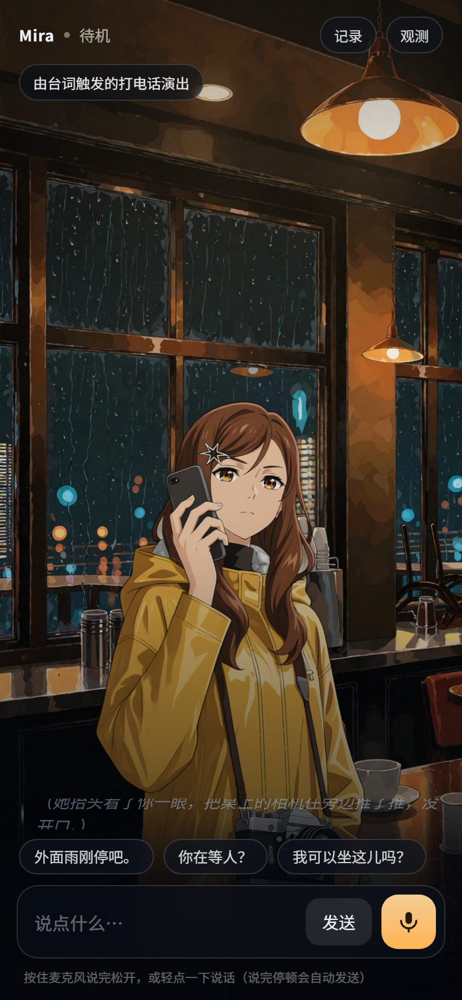
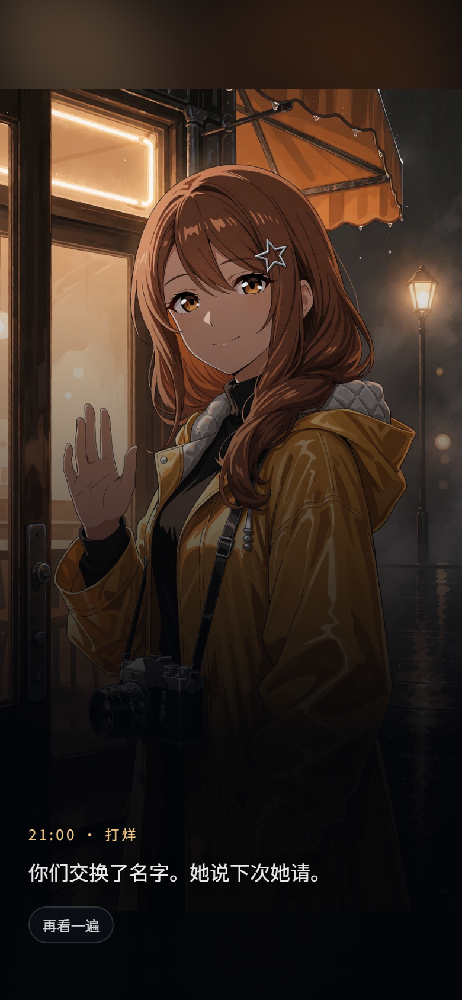

# Mira · 实时互动场景（72 小时实验）

暴雨刚停的夜里，一家即将打烊的咖啡馆。Mira 坐在窗边等一个人——她的手机从七点起就没电了。
你可以打字，或按住麦克风和她说话。她**会开口（语音 + 字幕）、会变表情、会做动作、会换镜头
（打烊关灯）、会因为你这句话触发一段演出（把手机借给她之后的那通电话 / 雷闪）**，
她说话时你随时可以打断。场景时钟 20:30 走到 21:00，剧情收束到三个结局之一。

不是聊天列表：整屏都是场景和角色，交互入口只是一条字幕区 + 一个输入坞。

> **这个仓库里有什么**：源码（`app/`）、运行必需的卡与素材（`cards/`）、设计文档（`docs/`）、
> 题目要求交付的演示录屏（`production/`）。
> 开发期的验收截图、抽帧、录屏原始分段、逐日计划与评审记录**不在仓库里**——
> 需要时用 `tools/qa/` 下的脚本重新生成。


---

## 1. 快速开始

### 1.1 先跑起来（零下载，Mock 模式）

```powershell
powershell -ExecutionPolicy Bypass -File .\start.ps1
# 或者双击 start.bat
```

打开 <http://127.0.0.1:8787/>，点「进入场景」。首次运行自动建 `.venv`、装依赖。

**这个仓库不包含模型权重和推理二进制**：`.gitignore` 排除了 `models/`
（开发机上约 82 GB）和 `tools/llm/llama/`（llama.cpp + CUDA 运行时约 1.2 GB）。
所以在一台干净的机器上，启动器探测不到本地模型，**自动走 Mock 模式**——
剧本按你的话推进，但走的是**同一条代码路径**：同一个 NDJSON 流、同一套指令协议、
同一个前端状态机；四种状态、6 种表情、6 种动作、镜头/环境切换、剧情节点与
三个结局全部可复现。

> 这不是「残缺版」，是刻意设计的可复现兜底。面试演示最大的风险是网络/额度/环境，
> Mock 保证换任何一台机器都能看到完整流程，而且每一步都能在观测面板里核对。

### 1.2 接真实模型（可选，需自备一个 OpenAI 兼容后端）

对话由谁生成，只看 `:8080` 上有没有一个实现了 `POST /v1/chat/completions` 的本地服务。
三种接法任选：

**A. 一键下载**（Windows + NVIDIA，约 3.4 GB）

```powershell
powershell -ExecutionPolicy Bypass -File .\tools\llm\fetch_llm.ps1   # llama.cpp + 4B 权重
powershell -ExecutionPolicy Bypass -File .\tools\llm\start_llm.ps1   # 起 :8080
$env:LLM_MODE="llama"; powershell -ExecutionPolicy Bypass -File .\start.ps1
```

**B. 用你已有的 Ollama / LM Studio / vLLM**
让服务监听 `127.0.0.1:8080`（或设 `LLAMA_BASE_URL` 指过去），再 `$env:LLM_MODE="llama"` 启动。

**C. 什么都不装** —— 就是 1.1 的 Mock 模式。

本项目实测用的是 [`empero-ai/Qwen3.8-4B-Distill-GGUF`](https://huggingface.co/empero-ai/Qwen3.8-4B-Distill-GGUF)
的 `Q4_K_M`（2.8 GB，Apache-2.0）。**两个坑先说在前面**：

- 它是 qwen35 **混合架构**（Gated DeltaNet），必须用**较新的** llama.cpp（本机实测
  build 11729 / `0.7.0-dev`），旧版本会直接加载失败——这不是本项目的问题，是模型架构决定的；
- 它是推理模型，原始输出带 `<think>` 块。`app/providers.py` 里已有剥离与首 token 预算。

换别的模型也能跑（任何 OpenAI 兼容后端都可以），只是措辞质量会变：提示词与闸门是按
4B 调的，往上换 7B/14B 通常更好，换到 1B 以下会明显退化。

启动器会按顺序探测三件事，**缺任何一件都还能跑**：

| 依赖 | 有 | 没有 |
| --- | --- | --- |
| LLM（`LLM_MODE=auto`，默认） | 启动时探一次 `:1234`：有服务则链为 `25B → 4B`，没有则链为 `4B` | 退回 **Mock**：剧本按你的话推进，仍是同一条代码路径 |
| TTS | 卡里 `character.voice.engine: edge`，走 edge-tts（免费、无 Key） | 无网时降级为字幕 + 浏览器 `speechSynthesis` |
| 神经音色侧车（可选） | 本机有 `mira-tts` conda 环境时可 `MIRA_TTS_ENGINE=neural` | 默认不启动，省 ~20s 启动与 ~2GB 显存 |

> `:1234` 是**可选档**：Strata 25B MoE（`StrataLLM`）。`auto` 的做法是启动时**探一次**这个端口——
> 开着就把它排到链首（`25B → 4B → Mock`），没开就直接 `4B → Mock`。**没有运行时超时损耗**，
> 不存在「每一轮先撞一次 25B」。空机器上这个端口不会有服务，所以陌生人拿到的链就是
> `4B → Mock`，不需要任何配置。`LLM_MODE` 显式设成 `llama` / `mock` 可以跳过这次探测。

页面右上角「观测」可以在运行时切换 provider、注入故障、查看状态事件与耗时。

| 地址 | 用途 |
| --- | --- |
| `/` | 互动场景 |
| `/debug` | 观测页：一次互动的状态事件、耗时、错误 |
| `/api/health` | 健康检查（含实际 provider 与 voice 引擎） |
| `/api/card` | 卡包快照：指令枚举 + 素材绝对 URL + 表演通道表 |
| `/api/history/{sid}` · `/api/trace` | 会话回放 · 每轮决策轨迹 |

> 麦克风需要 `localhost` 或 https 环境（浏览器安全上下文），本机 127.0.0.1 满足。

---

## 2. 题目要求 → 本实现

| 题目要求 | 实现 | 位置 |
| --- | --- | --- |
| 场景为视觉主体、非聊天列表 | 全屏舞台（背景板 + 角色贴片）+ 字幕 + 输入坞，无消息气泡 | `app/static/index.html` |
| 移动端优先、桌面正常 | 移动端整屏竖屏（`max-width: 560px`）+ `100dvh` + 安全区适配；桌面端居中成 600px 取景框、垫模糊余光底图 | `style.css` |
| 待机/倾听/思考/说话 四状态 | `data-state` 驱动角色微动、指示灯、字幕区形态 | `app.js:setState` |
| 文字 + 麦克风输入 | 输入框 / 按住说话或轻点录音（`MediaRecorder` → `/api/stt`），带录音计时、电平、取消 | `app.js:startMic` |
| 语音回复 + 同步字幕 | 逐句 TTS，音频播放时才把该句推到字幕；停顿由服务端后处理重插 | `main.py:tts_worker` / `app.js` |
| 多轮连续互动 | 服务端 `Session` 持 history、观众事实、反重复台账；剧情由节点图推进 | `main.py:Session` / `app/story.py` |
| 语音打断 | 按下麦克风 = 本地停播 + 清空队列 + 服务端 `epoch+1` 取消协程 | `app.js:interrupt` / `main.py` |
| 被打断的回复立即失效 | 每个事件带 `seq`，客户端丢弃旧 seq；服务端 epoch 失效后不再下发 | 见 §4 |
| 结构化角色/场景指令 | **首行 JSON 指令 + 换行 + 台词**，5 个维度、白名单收敛 | `card.yaml` / `main.py:header_probe` |
| 一份数据三处用（卡包） | 卡包同时驱动提示词、指令枚举、客户端素材清单 `/api/card` | `cards/mira_cafe/card.yaml` / `app/cards.py` |
| ≥3 种情绪 | neutral / smile / worried / surprised / thinking / listen，**6 张独立表情贴片** | `cards/mira_cafe/assets/char/` |
| ≥2 种非说话动作 | look_window / sip_coffee / check_phone / lean_in / phone_call / stand，**6 张独立动作贴片** | 同上（`idle` 复用表情贴片） |
| ≥1 次背景/镜头/环境变化 | `lights_dim` 吊灯熄灭（环境层叠加，收尾拍固定触发）。**镜头推拉刻意取消了**：整台舞台逐帧重采样会让「说话时画面闪」，收益只有 2% 的观感；`window_close` 的属性保留，留给将来整数像素平移的运镜 | `app.js:applyScene` |
| ≥1 个由对话触发的视觉事件 | **接电话演出**（剧情节点 `phone_call`）/ 雷闪（台词含「雷」触发）/ 结局静帧 | `card.yaml:fx` / `app.js:triggerEvent` |
| 一种多模态表现能力 | **分层舞台 + 卡驱动的程序合成演出**：贴片叠化换脸、呼吸微动、按音频时钟排的动作 beat；闪电补光、滚雷、屏幕冷光、结局静帧全部程序合成 | `app.js:showSprite` / `app/perf.py` |
| 素材加载/结束/打断处理 | 「静帧加载中」徽标、`onload` 收层、打断即清 `src` | `app.js:showStill` / `hideCinema` |
| 生成中状态与失败处理 | 加载徽标、失败降级为暗角 + 徽标、闪电/车灯天然不需要素材 | `app.js:degradeEvent` |
| 模型超时/断线/失败反馈 | LLM 首 token 9s 预算换下一档、TTS 失败降级、故障可注入可复现 | `main.py` / 观测面板 |
| 快速连续输入不播失效回复 | `seq` + `epoch` 双保险（见 §4） | `app.js:sendTurn` |
| 无密钥可体验 | Mock 模式（没有模型权重时自动退回） | `app/providers.py:MockLLM` |
| 一条命令启动 | `start.ps1` / `start.bat`（探测 → 按需拉起 → 起服务 → 开浏览器） | 仓库根目录 |

---

## 3. 系统结构

```
① 内容层：卡包（数据驱动，一份数据四处用）
  cards/<card_id>/
    card.yaml
      ├─ character：人设 / 外形 / 事实清单 / 边界 / 声音参数
      ├─ scene    ：时间、天气、机位 POV、打烊细节、环境音
      ├─ story    ：20 个节点的故事图（ask 语义锚点 / goto 条件 / 三结局 / leave_triggers）
      ├─ clock    ：场景时钟 20:30→21:00，1.5 分钟/轮；三个强制节点
      ├─ understanding：理解层的场景门（阈值、跑题时用旁白接住）
      ├─ directives：emotion / action / scene / effect / event 五个枚举 + default
      ├─ channels ：5 个表演通道（speech/face/body/hand/gaze）+ 谁能抢谁
      ├─ actions  ：7 个动作占哪些通道 / 能不能在说话时播 / 降级目标
      ├─ corrections：台词 → 表现的第二段校正规则（只准降级）
      ├─ fx       ：8 个特效实例 + 5 条 cue（程序只提供六个原语）
      ├─ tts      ：情绪语气 + 句级韵律 + 句间停顿
      └─ assets   ：贴片 / 场景板 / 结局静帧 / 音频，**相对卡根**
    presets.yaml ：14 条预设台词（barks），带 act / rel / beat / 优先级 / 冷却 / 多变体
  app/cards.py：加载 + 校验（枚举、引用、资源路径、节点引用、fx 实例）+ 生成客户端快照
        │  三处消费：① 提示词渲染  ② 服务端指令白名单  ③ GET /api/card → 前端素材绝对 URL
        ▼
② 服务端：FastAPI 单进程（app/main.py 约 2.9k 行）
    ├─ Session：seq（轮次）、epoch（打断代）、history、节点状态、user_facts、trace
    ├─ 一轮 = run_turn：
    │    记忆抽取 → 场景门（decision/selector）→ 言语行为 act（acts）
    │    → 预设命中？→ 命中直接出字（presets）/ 未命中 → 导演层给内容骨架（director）
    │    → 4B 流式生成 → 首行指令解析（header_probe）→ 白名单收敛（sanitize）
    │    → 首句闸门（topic/禁词/复读/时间）→ 表演排期（perf + channels）
    │    → 逐句 TTS 合成 → NDJSON 下发
    ├─ 剧情：story.py 节点图（纯函数，0 延迟）+ clock 硬闸门
    ├─ providers：MockLLM / LlamaLLM / StrataLLM / DeepSeekLLM / edge-tts / faster-whisper
    └─ 路由：/ /debug /api/health /api/card(s) /api/session /api/turn /api/interrupt /api/stt
            /api/history/{sid} /api/events/{sid} /api/trace /api/tts_stream /api/tts_file
            /api/cloud /api/warm /api/debug/inject /card-assets/{id}/…
        ▼
③ 客户端：原生 HTML/CSS/JS（无框架、无构建步骤，不持有剧情真相）
  app/static/（index.html 202 行 / style.css 679 行 / app.js 约 3.6k 行）
    ├─ 场景层：背景板（固定静帧）+ 角色贴片（alpha）+ 雨痕/闪电/暗场/颗粒
    ├─ 演出层：静帧照片（推近）+ 闪电补光 + 屏幕冷光 —— **没有 <video>**
    ├─ 状态机：idle / listening / thinking / speaking
    ├─ 音频：WebAudio 环境音（程序合成雨声底噪）+ 逐句 Audio 队列
    ├─ 表演：通道仲裁（同一通道同时只有一个动作）+ 按音频时钟解析 beat
    └─ 输入：文本 + 按住说话 / 轻点录音（MediaRecorder + 自适应 VAD）
```

一次 turn 的事件流（NDJSON，每行一个 JSON，均带 `seq`；客户端处理 17 种事件）：

```
state(thinking) → turn_start → directive → perf → subtitle_partial…
→ state(speaking) → audio(逐句) → directive_patch? → reply → done
```

指令**先于**台词和音频发出：`emotion` 到得早，第一句 TTS 就能用对应语气合成，
表情/镜头也和第一句语音同时发生，而不是等整段说完才知道她是什么情绪。
`directive` 事件里带 `fixes`（白名单收敛、节拍闸门、关键词兜底、台词校正各自的说明），
观测面板可见。`done` 事件带 `provider`、`first_text_ms`、`gate`、`dialog_fix_n`、`tts_cache`。

---

## 4. 语音与打断：为什么这样做

### 4.1 打断链路（按住说话即打断）

1. `pointerdown` 麦克风 → **先在本地** `stopPlayback()`：暂停当前 `Audio`、清空待播队列、
   取消浏览器语音、收起演出层并清空字幕 —— 这一瞬间画面上已经"停下"。
2. 立刻 `POST /api/interrupt`：服务端 `epoch += 1` 并 `cancel()` 正在跑的 turn 协程。
3. `getUserMedia` 开始录音，状态切到「倾听」。
4. 松手 → `/api/stt` → 转写文本 → `POST /api/turn` 作为新一轮（新 `seq`）。

### 4.2 迟到的响应为什么不会覆盖新状态

双保险：

- **客户端**：全局 `S.activeSeq`。任何事件 `ev.seq !== S.activeSeq` 直接 `continue`。
- **服务端**：每个 turn 捕获自己的 `epoch`；`emit()` 发现 `epoch` 已失效就抛 `TurnCancelled`，
  协程立即结束，不会再有新事件写进流。

所以「上一轮迟到的网络响应」既不会被发出，也不会被渲染。

### 4.3 麦克风：为什么是「按住说 + 轻点说」两种手势，不用纯自动 VAD

- **按住说话**给用户一个**明确的打断意图**，不需要区分"嗯/对"这类附和音和真正打断（这是题目
  可选扩展里最难的部分，本机没有可靠的 AEC，容易让角色听到自己的声音）。
- **轻点一下**也能录：说完停顿 1.15s 自动发送，再点一下立刻发送。很多人第一次用会"点一下然后
  说话"，如果只支持按住，他们会以为话筒坏了。
- 录音时界面上有**计时、电平条、取消**。这三种东西比任何提示文案都管用：
  用户能自己判断"我有没有被听见"。

这一版改之前，实测踩过三个会让用户认为「话筒无法说话」的坑（都修了，注释写在
`app.js` 的麦克风段落里）：

1. 只在 `audio/webm;codecs=opus` 上建 `MediaRecorder`：Safari / 部分 Edge 直接抛
   `NotSupportedError`，而构造代码没有 try，**录音机根本没建起来**，界面还停在「倾听」。
   现在按 `webm/opus → webm → ogg/opus → mp4 → aac` 逐个探测，并且构造也包了 try/catch。
2. 静音自动发送的阈值写死成 `rms > 0.012`：笔记本内置麦 + 强降噪时永远到不了，
   `speechAt` 一直是 0 → 「说完等半天没反应，一直录到 15s 上限」。现在先估底噪、
   阈值取 `max(0.006, floor×2.4)`，并且要求检到足够多语音帧才允许自动发送。
3. 她说完最后一句时字幕被清空、这一轮又没有任何可见反馈 → 用户以为「刚才什么都没发生」。
   现在字幕保留到最后一句，未识别/太短/被拒/被占用都有具体提示。
---

## 5. 角色 / 场景指令协议

**协议 = 第一行一个 JSON 对象，换行之后才是要说的台词**（模型被 system prompt 要求严格这么输出）：

```json
{"emotion":"worried","action":"look_window","scene":"cafe_night","effect":"rain","event":"none"}
这雨下了一整天，我都有点忘了它停下来的样子。
```

为什么把指令放在**开头**而不是结尾：流式输出里指令先到 → 服务端在第一个换行处就拿到
`emotion`，于是**这一轮的第一句语音**就能用对应语气（rate/pitch/volume）合成，表情和镜头
也和第一句语音同时切换。放结尾的旧格式（`###DIRECTIVE###` + JSON）仍被兼容，作为模型
不听话时的降级路径；此时 `directive` 事件标 `parsed:false` 并记录一条 fix。

服务端 `header_probe()` 按**括号配对**扫描首行（不是 `split("\n")[0]`），JSON 没闭合前
一个字都不送去 TTS；`finalize()` 按顺序做四件事：

1. `sanitize_directive()` **白名单收敛**：不在枚举内的值回退默认，写进 `fixes`；
   （小模型会自创 `emotion:"listening"`，这步把它收敛成合法值而不是报错）
2. **本拍固定表现 `pin`**：收尾拍必须出现「灯光转暗」的环境变化，不交给 4B 随机决定；
3. `guard_story()` **节拍闸门** + **事件去重**：还没到的事件拦下，已经演过的事件不再重播；
4. `keyword_event()` **内容触发兜底**：4B 小模型经常只给 `event:"none"`，若用户这句话里
   确实出现了触发词（「雷 / 闪电 / 打给 / 拨 / 打通 / 铃声」）、节点允许、且这个事件还没放过，
   就补一个——事件权限仍然绑在台词内容上，不是计时器。

复现这套协议的最小方法：`tools/qa/turn_api.py` 把每一轮的 NDJSON 原样打印，
`tools/qa/probe_json_shell.py` 用真模型反复采样（专门测「协议 JSON 漏进字幕/语音」这一类）。

### 5.1 一轮对话是怎么被决定出来的（这一版最大的结构变化）

第一版把「读懂你说什么、决定她演什么、把话说自然」三件事全塞给 4B，结果是
「技术上合规、体验上答非所问」。现在拆成**三层，各管一件事**：

```
用户这句话（打字 / STT）
  │
  ├─① 记忆抽取        extract_facts()                              main.py
  │     「他叫什么 / 为什么这么晚 / 被雨淋了」→ Session.user_facts
  ├─② 场景门          selector.py（cross-encoder 选择题）/decision.py（三级链）
  │     先问「这句话还在这个场景里吗」，门外的话走陌生人状态，不硬答
  ├─③ 言语行为        acts.py 正则分类：招呼/应答/道谢/告别/沉默/闲聊/越界/出戏/提问
  ├─④ 预设优先        presets.py：命中 act 直接出预置台词（0 生成 + 预合成音频）
  │     14 条 bark，每条 3 变体轮换、同拍连续命中 2 次后强制走生成
  ├─⑤ 生成兜底        director.py：给这一轮**该传达的事实骨架**（content / anchors / 禁词）
  │     4B 只负责把已定的意思说成她的口吻，不参与「说什么」
  ├─⑥ 首句闸门        句子完整时先校验再送 TTS：话题锚点 / 硬禁词 / 英文词 / 复读 / 旁白腔 / 时间白名单
  │     不过则等第二句，两句都不过才丢弃重写一次，再不过用对题兜底
  └─⑦ 表演排期        perf.py 出带时间锚的 beat 列表 → channels.py 仲裁冲突 → 客户端按音频时钟演
```

三条设计依据（也都写了失败案例）：

- **约束写得太硬，模型就会用答非所问来满足约束**。第一版提示词要求「1–2 句、不超过 45 字、
  情绪藏在动作里」还要求「被问到在等谁时回避」，4B 选了最省事的路：转移话题。现在第 1 条
  铁律是「先回答，再延伸；不想说就否认/反问/挡回去，不允许用天气代替回答」。
- **小模型不适合既当考生又当阅卷人**。判「问的是哪件事」交给一个只能从固定候选集里选一个的
  cross-encoder（`selector.py`，一次前向 26 个候选，CPU 实测约 100ms/轮），4B 被告知答案。
  没装 torch 时这一层降级成关键词门，返回里标 `backend=keyword`，质量差一档但演示不依赖它。
- **状态更新绝不能放在 emit 之后**。曾有一个 `beat_advance(text=...)` 参数名写错（签名是
  `user_text`）的 bug：异常发生在 `emit("reply")` 之后、`history.append` 之前，又被兜底
  `except` 吃掉，于是**每一轮的历史都没写进去**，模型永远在「第一次见你」的上下文里说话。
  现在历史在 `emit(reply)` 之前落库，异常栈写进会话事件日志。

结构、数据流、判据与 before/after 真实台词见
[`docs/DIALOGUE_LOGIC.md`](docs/DIALOGUE_LOGIC.md)（写于 2026-10-20，覆盖到导演层与首句闸门；
之后新增的预设库 / 决策层 / 表演排期见 §5.1 与 §5.3，以及
[`docs/DIALOGUE_WORKFLOW_V2.md`](docs/DIALOGUE_WORKFLOW_V2.md)）。

### 5.2 剧情推进：故事节点图（`app/story.py`）

v14 起「线性七拍 + 话题命中够两次才推进」整体换成**节点图**，写在
`cards/mira_cafe/card.yaml` 的 `story.nodes` 里：**20 个节点、三个结局、一条借电话分支**。
判定全部是**纯函数**（不调模型、不看台词生成结果），所以 0 延迟、可单测。

推进有三条路，优先级从高到低：

1. **本节点的语义分支**：`ask_any`（用户这句话命中了本节点声明的话题词）/ `flag`
   （借电话）/ `roll`（电话 70% 打通）/ `clock_gte`。用户说到就当场跳，不看轮数。
2. **全表问句加速**（`_accelerate`）：本节点没声明、但**后面 4 个节点内**有节点声明了
   「说到这个词就该跳到那里」。实测价值：用户第 5 轮问「你要不打电话问问？」，此时真正
   声明了「电话 → 手机没电」的节点已经被兜底跳过——没有这一步，这句话会被整句丢掉，
   观感就是「剧情推不动、她自说自话」。
3. **兜底分支**：`turn_gte: N` 按"在本节点待满几轮"往前走，保证没人说话也会到收尾。

此外还有两条**硬闸门**（`clock.forced`）：20:48 必说「手机没电」、20:56 老板娘喊关灯、
21:00 无条件进结局。场景时钟按**对话轮数**走（`minutes_per_turn: 1.5`，20:30 → 21:00 约
20 轮），不随真实时间走 —— 否则用户发呆也算剧情在流逝。

三个结局由 `story.rules` 求值：`offered_phone == true` → 朋友结局；`== false` → 陌生人结局；
中途说「我要走了 / 该走了 / 再见」等（`leave_triggers` 15 条）→ 提前道别的第三结局。

> **2026-10-22 修过的三个真 bug（都在 `app/story.py` 里留了注释）**
> ① `tick()` 曾经在 `resolve()` 之前就把 `turns_in_node +1`，而每个节点的兜底 goto 都是
> `turn_gte: 1` —— 条件当场成立，**每轮必跳**，节点图退化成计时器，用户说的每句话都没
> 参与决定。现在 `end_turn()` 在 `resolve()` 之后调用。
> ② `forced()` 曾经只判「目标节点访问过没有」，挡不住**被问句加速跳过、但没访问过**的节点：
> 借了手机的路径走到 `release` 后，20:48 的强制点把她拖回第一幕 `phone_dead`，又按
> `offered_phone` 跳回 `phone_offer` —— 用户听到电话打了两遍。现在按**节点表位置**判，
> 强制点只许往前走。
> ③ `last_minutes` 只有一条 `clock_gte: 20:56` 的 goto、没有兜底，用户落进这一拍后要
> **空转 5 轮**才等到关灯，而这拍已经没新信息可说，模型只能反复道别、乃至编出「她来不了」
> 这种越界结论。现在补了 `turn_gte` 兜底，进结局从 20 轮压到 **14 轮（约 3–4 分钟）**。

| 字段 | 取值 | 前端表现 |
| --- | --- | --- |
| emotion | neutral / smile / worried / surprised / thinking / listen | 换角色贴片（叠加在固定背景板上，背景不动） |
| action | idle / look_window / sip_coffee / check_phone / lean_in / phone_call / stand | 动作贴片 + 镜头微推；按通道仲裁决定能不能插话 |
| scene | cafe_night / window_close / lights_dim | `lights_dim` 切暗场（环境层叠加）；`window_close` 目前只有属性、无视觉变化（推拉已取消，见 §8） |
| effect | rain / thunder / none | 雨后的屋檐滴水环境音、闪电补光 |
| event | none / thunder / phone_call / ending | 程序合成演出（见 §6），失败降级为最简演出 |

### 5.3 表演层：通道仲裁 + 台词二次校正（2026-10-21 起）

情绪/动作**不再让 4B 在首行 JSON 里自己选**，也不只是「意图查表」——查表看不见这一轮
到底说了什么，于是会出现「表里要掏照片、台词里根本没提照片」这种动作和台词互不相干的情况。
现在的链路是四段：

1. **通道规则进卡包**（`channels` + `actions`）：5 个通道（speech / face / body / hand / gaze），
   **同一通道同一时间只能有一个动作，不同通道可以叠加；说话通道优先** —— 任何要用到嘴的
   动作（喝水/吞咽/叹气/咳嗽）在她说话时一律不能播，按 `degrade_to` 降级（`sip_coffee`
   降级成 `look_window`）。`app/channels.py` 只做冲突判定与降级，服务端与客户端读**同一张表**
   （`/api/card` 的 `stage` 字段）。
2. **L0 即时表现**（0ms）：`director.py` 按意图先给一版表情与动作，客户端不必等模型首字就能换脸。
3. **台词落地后二次校正**（~0.7–1.2s）：`director.dialog_fix()` 用**真实台词**再校正一次，
   规则写在卡包 `corrections:` 段（8 条，数据不是硬编码），每个字段取第一条命中的规则，
   **只准降级、不许升级**：
   - 台词提到雨/窗外 → `look_window`；手机/电话/没电 → `check_phone`；咖啡/杯子 → `sip_coffee`；
   - **反向约束**（最有价值）：表里要演 `phone_call` 但台词里一个「打/拨/喂/电话」都没有
     → 降级成 `check_phone`（不许没头没尾地开始打电话）；
     `stand` 只允许在 `lights_dim` / 三个结局节点出现，早于此一律降级回 `idle`；
   - 她自己**说话时**一律不允许 `listen` 表情。
4. **表演排期**（`app/perf.py`，纯函数）：把「这一轮该演什么」变成带时间锚的 beat 列表 ——
   听到问题先顿一下再开口、顿的这段时间视线移开、手势落在句间停顿而不是开场一次做完、
   说完回到「听」的脸。客户端拿真实音频时长解析锚点后执行，不是按墙上时钟。

校正是**增量事件** `directive_patch`（只带 emotion/action），客户端立即应用；
`done.dialog_fix = {n, fixes, emotion, action}` 与 `logs/turns.jsonl` 的 `dialog_fix_n` 留痕，
观测面板的「台词校正」列显示每轮改了几次。

---

## 6. 多模态表现：由台词触发的演出（无视频）

> **2026-10-20：全部视频已删除。** 原来有 4 段 MP4（`thunder / photo_reveal / last_train /
> idle_loop`），由 AniSora 从另一套机位生成。问题很具体：它们的机位、光线、景深和底板
> 不是同一场戏，插进来那一秒等于"背景换台"，而且人物比例对不上。删掉之后演出改成
> **程序合成 + 一张静帧**，三个事件各自的物理都不一样：

| 事件 | 触发 | 表现 | 实现 |
| --- | --- | --- | --- |
| `phone_call` | **剧情节点** `phone_call`（借了手机 → 她按号码） | 角色换「手机贴耳」贴片 + 屏幕冷光闪一下 + 环境音压低 2.6s + 顶部徽标 | `applyAction` + `fx` 的 `phone_glow` |



> 上面这张是真实页面截图：贴片换成「手机贴耳」（这张贴片重出了 5 版才过验收），
> 顶部徽标说明这一拍是由剧情节点触发的。
| `thunder` | 台词里出现「雷 / 闪电 / 打雷」 | 三段冷蓝补光（`@keyframes lightning`）+ 低频滚雷（WebAudio 合成，无素材） | `doFlash()` + `rumble()` |
| `ending` | 进结局节点 | 整屏静帧（`ending/friend.webp` / `stranger.webp`）+ 徽标「21:00 · …」 | `handleEnding` → `showStill` |

卡包里 `fx` 段声明 **8 个特效实例 + 5 条 cue**（蒸汽、灯光呼吸、玻璃起雾、反光、冷光、
滚雷、两张结局静帧），程序只提供六个原语（glow / flash / particle / still / shade / audio），
「窗户在哪」「杯子在哪」由卡包的 `geometry.zone` 决定——所以特效是**数据驱动**的，
换卡不用改前端。

> 演出仍然是「插入镜头」：`photo_reveal` 这类整屏事件会进 cinema 层，结束后回到常驻舞台；
> 常驻舞台本身永远是「背景板 + 角色贴片」两层，**不依赖任何视频**，删视频不影响待机画面。

播放细节（题目要求的三件事，在无视频之后仍然成立）：

- **加载**：`showStill` 先显示「静帧加载中…」徽标，`onload` 才淡入并做 6s 推近。
- **结束**：定时收层、清 `src`、回到常驻场景。
- **打断**：`hideCinema()` 立即清 `src` 与定时器，未播完的演出不会继续。
- **失败降级**：`degradeEvent()` → 闪电只补光、照片退成暗角 + 徽标，绝不黑屏；
  观测面板的「演出降级」按钮可以随时注入这个故障。

> 为什么不再去生成替代视频：这类片段必须和底板同机位、同光线、同景深才不"跳台"，
> 而程序合成已经能把"画面变了、而且是因为你这句话变的"说清楚，成本是 0 素材、0 授权、0 加载。
---

## 7. 模型与素材

> **这一节讲的是「素材和模型是怎么做出来的」，不是运行依赖。** 仓库里没有权重、
> 没有 llama.cpp 二进制、也没有 ComfyUI 工作流的原始工程；运行只依赖 `requirements.txt`，
> 接真模型的方式见 §1.2。素材（`.webp` + `manifest.json`）在 `cards/` 下，是交付物。
>
> 素材审核与历史见 [`docs/ASSETS_REVIEW.md`](docs/ASSETS_REVIEW.md)。
> **注意**：那份文档记录的是前三轮（Qwen-Image → animagine SDXL）的审核过程；
> 当前线上素材是第五轮之后的产物，规格见本节。

| 用途 | 方案 | 说明 |
| --- | --- | --- |
| 场景背景板 | **Qwen-Image 2.1 出构图 → animagine-xl-4.0 重画** | 先要「结构正确」的实拍感场景，再用动漫底模高 denoise 重绘成 2D 赛璐璐，最后对齐 864×1536 并统一调色 |
| 角色 / 表情 / 动作 | **Krea-2 Turbo v10**（`JANK2AnimeKrea2Turbo_v10`, int8） | UNET + `CLIPLoader(type=krea2)` + `qwen3vl_4b_fp8_scaled` + `qwen_image_vae`；10 steps、CFG 1.0、euler/simple，1728×3072 直出后 premultiplied 降采样到 864×1536 |
| 电话贴片（1 张） | **Qwen-Image-Edit** 参考图精修 | 姿态对、但 edit 的 reference latent 会留半透明重影；v18→v19→v19_clean 三轮只做清理，不改姿势/身份 |
| 角色抠像 | rembg `isnet-anime` + 连通域清理 | 得到带 alpha、与背景板同机位同尺寸的贴片 |
| 配准 | `register_poses.py`：头顶点 / 头宽 / 头中心 x | 12 张是分别重画的，lean_in 镜头更近、头还偏过 20–60px；只求整体缩放 + 平移，**头对头** |
| 演出（已删视频） | ~~AniSora V3.1（Wan2.1-I2V-14B fp8）~~ → 程序合成 + 一张静帧 | 原来生成 4 段 MP4，机位/光线和底板不是同一场戏，2026-10-20 全部删除；现在闪电/车灯用 CSS + WebAudio 合成 |
| 对话 | Mock 剧本 / Qwen3.8-4B（llama.cpp，OpenAI 兼容） | 真实模式完全本地，无云端密钥；**权重不进仓库**，获取方式见 §1.2 |
| TTS | edge-tts `zh-CN-XiaoyiNeural`（rate -6%，pitch -8Hz） | 免费无 Key；按句流式合成、同文本缓存命中 0 开销 |
| STT | faster-whisper `small`，CPU int8，VAD | 热身后 2.2s 语音约 2.2s 转写；`WHISPER_SIZE=base` 可降到 0.8s |

### 7.1 当前素材：12 张贴片，一套布局

```
cards/mira_cafe/assets/
  char/   neutral smile worried surprised thinking listen      ← 6 张表情
          look_window sip_coffee check_phone lean_in phone_call stand  ← 6 张动作
          manifest.json（bbox / 配准参数 / 美术溯源字段）
  plate/cafe_night.webp（864×1536，无人物的空场景）
  ending/friend.webp · stranger.webp（两张结局静帧）
  fx/softdot.webp（粒子贴图）
  audio/sample_user.wav · sample_user_2.wav（「用户示例语音」）
```

**素材跟着卡走**（2026-10-22，v17）：一张卡 = 一个目录 + 一个 URL 前缀
`/card-assets/<card_id>/`。加第二张卡不需要改代码，删卡 = 删目录，回滚 = 整棵搬回去。
前端不拼任何素材目录名——`/api/card` 下发的是**绝对 URL**，客户端只负责用。
（旧布局把所有卡的素材塞在 `app/static/assets/`，第二张卡必然撞名。）

12 张的分工：`idle` 没有独立贴片，复用当前表情；`stand` 是站姿，只在关灯与结局出现。
**没有中间过渡帧**——见 §10 第 4 条，那一批已整体下架。

### 7.2 为什么用「场景工作流 + 角色工作流」而不是一张图

| 做法 | 换表情时背景 | 换角色时场景 | 机位一致性 |
| --- | --- | --- | --- |
| 单张全帧图（第一版） | 背景一起重绘，灯/窗会抖 | 整张场景跟着变 | 靠 seed + img2img 近似，不稳定 |
| **背景板 + 角色贴片（当前）** | **背景像素不动** | **只换贴片，场景不动** | 贴片与背景板同尺寸同机位，几何上对齐 |
| Live2D / Inochi2D 绑定 | 不动 | 需重做绑定 | 最灵活，但 72h 内做不出可用绑定 |

第一版的问题是**场景和人物被烘焙在同一张图里**：5 张表情是同一张全帧图的 img2img 差分，
换脸时整间店都在轻微抖动。拆成两层之后，`tools/qa/layers_test.py` 在真实页面里冻结背景断言：
换表情只改变角色 alpha 之外的 **0.08%** 画面（阈值 1.5%），镜头变换作用在同时包住两层的 `.stage` 上。
只要「换 A 会导致 B 也变」，说明 A 和 B 还共用一个不可分割的产物——修法是在生成侧拆开，
不是在前端用交叉淡化掩盖。

### 7.3 素材返工：为什么第一版「不像那家店」

第一版素材做完后，实际看着有三类硬伤（也是我自己给这一版的差评）：

1. **机位穿帮**：顾客是坐在桌边的客人，画面却给了「吧台制作区内部」的视角，她站在吧台后面
   对着镜头笑——像店员迎客，不像在等人。
2. **天气错了**：应该是「暴雨刚停」（湿地面、玻璃水痕、屋檐滴水），画面里却是正在下暴雨。
3. **打烊的细节没有**：没有客人走后没收的餐具、没有吧台水槽里待洗的杯子、没有翻到桌上的椅子、
   没有灭掉的 OPEN 灯牌；吊灯全亮着。
4. **角色道具丢了**：银色星星发夹不明显、相机根本没画出来、神态不对（该焦虑在等人，不该是笑脸）。

原因不是「模型不够强」，而是**五层资产被挤进了一条 prompt**：身份 / 道具 / 表情 / 场景 / 机位。
一次生成只能稳住其中两三层，剩下的必然崩，而且每次崩的位置还不一样。其中「机位穿帮」的机制
很具体：prompt 里写了洗碗池、待洗杯具这些**当前机位根本看不见**的道具，模型为了满足 prompt，
只能把机位挪到看得见它们的地方。

修法（细节见 [docs/research/turnaround_workflow.md](docs/research/turnaround_workflow.md)）：

- **机位-道具分配表**：A 机位（客人视角越过桌面）只准写这个机位看得见的打烊细节，
  洗碗池留给反打机位；
- **场景板先定稿、再合成角色**：先出「空的、雨后、打烊中」的 plate 并逐项过验收清单，
  再把 Mira 放到窗口那个座位；
- **三视图当身份锚**：正/侧/背逐角度出图，只用来锁「脸/发型/发夹/雨衣/相机」；
- **表情只裁头肩单改**：每次回锚图派生，绝不链式往下改（否则越改越飘）；
- **道具用位置绑定 + 局部重绘**：发夹、相机这种小物件靠局部 crop 重绘和贴片兜底。

> **素材生成脚本不在仓库里**：它们依赖本机的 ComfyUI 与十几 GB 模型权重，属于开发期工具，
> 不满足「clone 下来就能跑」的交付标准。仓库只带**运行必需的成品素材**（`cards/` 下的注册位）。
> 需要重出素材时，按本节的工作流描述在 ComfyUI 里重建即可；`tools/gen/` 里留了两个
> 与运行/验收相关的脚本（`gen_turn.py` 的产物结构、`integrate_turn.py` 的调色与落位规则）。

素材全部自制（AI 生成 + 本地推理），无第三方版权素材；未使用任何私有 API Key。

---

## 8. 关键技术选择与取舍

1. **不用 Live2D / Rive / Spine，用「背景板 + 角色贴片 + 程序合成演出」**
   Live2D 需要拆分图层与绑定，72 小时内做不出可用的二次元角色；Rive/Spine 同理。
   改为分层舞台：场景是固定的一层背景板，角色是带 alpha 的贴片，表情/动作只换贴片，
   但**不做镜头推拉**：整台舞台在 1.2 秒内被连续缩放＝每一帧都重采样整幅画面，
   那是「说话时闪」的最大来源（实测 stage transform 变化 49 次/秒），推近只有 2% 的观感收益，
   直接取消；`transform` 留给将来做「整数像素平移」那种不重采样的运镜。
   代价照实说：一层贴片做不了点头、侧倾、呼吸时肩膀的真实形变——这是这条路线的天花板。
2. **不做端到端语音模型，用 STT + LLM + TTS 三段式**
   端到端语音模型（如 Moshi）本机没有可用的中文权重，且难以插入"打断即停"的确定性控制。
   三段式每一步都可中断、可降级、可观测，符合题目对打断的严格要求。
3. **NDJSON 单流而不是 WebSocket**
   一次 turn 的所有事件必须**严格有序**且能整体取消；HTTP 流 + 轮次 `seq` 天然具备
   "这条流属于哪一轮"的语义，取消只需 epoch+1，比维护双向通道状态更简单。
4. **打断 = 本地先停 + 服务端取消**
   只靠服务端取消会让音频继续播 100-300ms；只靠本地会让服务端继续烧 TTS。两边都做。
5. **Mock 优先**
   面试演示最大的风险是网络/额度/环境。Mock 模式是**真实代码路径**（同一套流、同一套指令、
   同一套前端状态机），只把「LLM 文本生成」换成剧本，因此能保证演示零失败，也方便自动化测试。
6. **演出的加载/结束/打断/降级仍然完整实现，只是素材从视频换成了静帧与程序合成**
   题目要求"使用视频时处理加载、结束、打断"，现在没有视频了，但这四件事一条没少：
   静帧有加载中徽标/`onload` 收层/`hideCinema()` 即清 `src`/失败退成暗角 + 徽标。
   为什么不再去生成替代视频：实时生成 3 秒片段要 1–3 分钟，与互动节奏冲突；离线预生成
   又必须和底板同机位同光线才不"跳台"，那还不如用 CSS/WebAudio 合成——0 素材、0 加载。
---

## 9. 观测、降级与测试

- 页面「观测」面板：provider 切换、故障注入（LLM 超时 / TTS 失败 / TTS 变慢 / 演出降级）、
  实时事件流水、首包与总耗时、台词校正次数。
- `/debug`：独立观测页，读取 `/api/events/<session>`，展示 turn 耗时、错误、provider 健康。
- `logs/turns.jsonl`：每轮一行 trace（决策依据、闸门动作、延迟），`MIRA_TRACE=0` 可整层关掉。
- 降级链：TTS 失败 → 字幕 + 浏览器 `speechSynthesis`（可关）；演出降级 → 闪电只补光、
  照片退成暗角 + 徽标（不黑屏）；LLM 超时 → 换下一档 provider，界面不假装成功。

降级是**可见**的：`done` 事件带 `provider`（card / llama / strata / mock / cloud），
观测面板「模型」一行随之变化。曾经有一版降级是静默的——掉到 mock 时界面照样回一句很像样的话，
没人知道背后没调模型；现在链内每个 provider 有首字预算（`MIRA_FIRST_TOKEN_BUDGET`，9s），
超了就换下一个，换了几次都写在事件里。

自动化测试。先装测试依赖（运行依赖里刻意不含它们）：

```powershell
.\venv\Scripts\python.exe -m pip install -r requirements-dev.txt
.\venv\Scripts\python.exe -m playwright install chromium
```

然后起服务（`start.ps1`，或 `LLM_MODE=mock uvicorn app.main:app --port 8787`），逐条跑：

```powershell
# 端到端：流完整性 / 指令枚举收敛 / 关键词事件 / 打断 / STT 中文转写
.\.venv\Scripts\python.exe tools\qa\api_test.py            # 19/19
# 分层不变量：换表情/换动作只改角色层，房间像素不动；镜头推拉必须保持关闭
.\.venv\Scripts\python.exe tools\qa\layers_test.py         # 4/4
# 纯函数单测（不需要服务）
.\.venv\Scripts\python.exe tools\qa\dialogue_units.py      # 116/132
.\.venv\Scripts\python.exe tools\qa\empty_reply_units.py   # 31/31
.\.venv\Scripts\python.exe tools\qa\exit_gate_units.py     # 18/21
# 真实浏览器 + 假麦克风（8787）
.\.venv\Scripts\python.exe tools\qa\mic_test.py            # 按住说话 → 真 STT → 她开口
.\.venv\Scripts\python.exe tools\qa\mic_tap_test.py        # 轻点 + 停顿自动发送
# 探针（打印逐轮证据，不做断言）
.\.venv\Scripts\python.exe tools\qa\chat_probe.py          # 12 轮固定台词的对话质量
.\.venv\Scripts\python.exe tools\qa\dialog_fix_probe.py    # 台词二次校正命中率
.\.venv\Scripts\python.exe tools\qa\probe_json_shell.py    # 协议 JSON 漏进字幕/语音
.\.venv\Scripts\python.exe tools\qa\turn_api.py            # 单轮 NDJSON 原样打印
```

**这些数字是实跑出来的，包括没过的那些**（2026-10-22 复跑，mock 档）：

| 脚本 | 结果 | 说明 |
| --- | --- | --- |
| `api_test.py` | **19 passed / 0 failed** | STT 真实转写「你是在等什么人吗?」，1147ms / 2.26s 音频 |
| `layers_test.py` | **4 passed / 0 failed** | 换表情/换姿势时背景板变化 0.0000%；`camera off` 断言推拉确实是关的；`lights_dim` 真的切暗场 |
| `empty_reply_units.py` | **31 passed / 0 failed** | 覆盖「只吐首行 JSON」「骨架漏进台词」「JSON 与台词同行」「键名缺失」等全部已知形态 |
| `mic_test.py` | 通过 | `getUserMedia → MediaRecorder → /api/stt(1473ms) → /api/turn → /api/tts_stream(3 句)`，她真的开口 |
| `mic_tap_test.py` | 通过 | 轻点后 1.15s 静音自动发送（测试夹具本地拼「人声 + 尾部静音」） |
| `dialogue_units.py` | **116 passed / 16 failed** | 见下 |
| `exit_gate_units.py` | **18 passed / 3 failed** | 见下 |

两条红的，逐条能说清是什么：

- `dialogue_units.py` 的 16 条分两类：**① 旧剧情用例**（「第 1 拍被问照片」「相片在我雨衣内袋里」
  这些是 v14 把「照片道具」换成「手机」之前的断言，被测对象已经不存在了）；**② 真缺陷**
  （「你手机号码多少？」被判成 `photo` 槽位；「黑咖啡，不加糖」被当旁白拦下）。
  第二类是活的 bug，只是不在当前演示路径上——`presets.yaml` 的越界拒绝会先接住它。
- `exit_gate_units.py` 的 3 条：`two_years` / `rain_worry` / `ending_friend` 三个节点的
  mock 台词没被闸门拦下。最后一条尤其说明问题——**它的兜底台词自己不合格**，
  正是这个测试设计要防的形态。修法是按槽位给一句对题的话，还没做。

> 一个诚实的结果是：**测试红着交付，但每一红都写得出来为什么**。
> 也正因为如此，`beat_decision_test.py` 这轮被删了——它测的 `persona.beat_jump()`
> 已在 v14 被节点图取代（`main.py` 里连调用都没有），留着只会把「测死代码的绿」当成质量证据。

---

## 10. 已知问题

1. STT 在 CPU 上约 1x 实时（2.2s 语音 ≈ 2.2s），首次调用还要下载/加载模型（约 20s）；
   已用 VAD 裁剪静音，`WHISPER_SIZE=base` 可降到 ~0.8s 但中文标点会漂移（繁体/简体混出）。
2. 打断目前是「按住说话」显式打断；自动 VAD + 回声消除未做（本机无可靠 AEC 设备）。
3. ~~视频片段是离线预生成的固定 4 段~~ → **视频已全部删除**（2026-10-20）。
   演出改为程序合成，好处是不再有"素材和底板不同场"的跳台；代价是**没有真实运镜**，
   闪电和车灯本质是两层 CSS 光效，靠的是"由你这句台词触发"这个因果，而不是画面信息量。
4. **角色贴片是 12 张单帧，没有中间过渡帧**（这是这一版主动退回来的决定）。
   2026-10-21 确实补过整套过渡：7 个动作各 4 张中间帧 + 5 组表情过渡各 2 帧，
   另加 164 张过渡帧 + 24 张动作序列帧，写进清单、客户端按帧表播放。
   **但端点对不上**——末帧与现役姿态的差 δ=0.097–0.236，手臂还有重影；插帧之后
   观众看到的是「换姿势时抖一下」，比直接叠化更假。2026-10-22 全部移入
   `assets/char/_parked/v17/`（不再是交付素材），`playSequence` / `playTransition` 恒返回
   false，退回 **90ms 交叉淡化**。教训：中间帧的验收判据不是「帧数够不够」，
   而是**首末帧必须落在现役姿态上**；生成侧没对齐，播放侧再怎么补都是掩盖。
   仍然存在：换 `lean_in` 这类机位更近的姿势时，头对头配准之后肩线还是会有一次轻微跳动。
5. 桌面端是**居中取景框**（最大 600px）+ 同一张场景板的模糊余光底图，不是自适应大屏布局。
   题目只要求"桌面端可以正常体验"，这一版满足该要求但不算加分项。
6. Mock 剧本是节点图 + 关键词分支，不理解语义；真实模型模式的剧情节拍控制弱于剧本。
7. 单进程内存会话，重启后会话丢失（题目不要求账号系统）。
8. 对话质量：**主力是 4B（llama.cpp）+ 导演层 + 预设库 + 决策层**。导演层把「这一轮
   说什么」确定化（意图 / 事实骨架 / 机检 / 兜底），模型只做措辞。25B（Strata）保留为
   **对照档**：`LLM_MODE=auto` 启动时探一次 `:1234`，**有服务才把它排到链首**（本机当前
   就是这样在用 25B），没有则链是 `4B → Mock`——那是别人机器上的常态。前者在完全开放、
   导演层没预设的话题上仍然更强，但那属于「自由发挥的上限」，不是这个场景的必需品。详见
   [`docs/SMALL_MODEL_PLAN.md`](docs/SMALL_MODEL_PLAN.md)。
9. 4B 会自创枚举值（例如 `emotion:"listening"`）或只输出首行 JSON 就停。前者被白名单收敛、
   后者用本拍兜底台词接住，都会在 `fixes` 里留痕——**不假装是模型说对**。
   2026-10-21 又补了一道**时间白名单**机检：台词里的钟点、以及她**自己时间线上**的时长
   （「我在这里坐了四个半小时」）必须能在卡包事实表里找到出处，否则整段重写一次。
   仍然存在：模型偶尔会复读到被复读闸门拦下、重写仍复读，最后用本拍兜底台词。
10. TTS 仍是 edge-tts（在线服务，无 Key 但有网络延迟），**风格 SSML 被服务端 1007 硬拒**（实测，
    详见 `docs/research/tts_voice.md`），情绪只能靠语速/音高/停顿 + 后处理近似。
    已加 `app/tts/` 后处理：去 Edge 自带静音、按标点重插停顿/气口、小房间混响、高频柔化。
    **延迟（2026-10-21 实测）**：edge 云端合成「第一个音频块」就要 1.18–1.38s（哪怕两个字），
    整句 1.86–2.18s。现在的对策：语气词预合成成本地静态音频、首句软切 14→8 字、
    单句 TTS 超时 12s→**6s**；再用 `app/tts/live_edge.py` 的一条**保温 WSS** 复用连接
    （每次合成都重付 850ms 的 TCP+TLS+WSS 握手，把它藏进 LLM 首字里），首句边收 mp3
    边解码成 PCM 边播。浏览器实测可听起点 **p50 2482 → 1121ms**
    （`MIRA_TTS_LIVE=0` 可一键回到旧行为）。仍存在：有一条慢轮（长回复/重写路径）两档都在
    2.4–2.6s；一条 WSS 上的合成是串行的，两个会话同时说话会互相排队（未测）。
    **本地神经 TTS（CosyVoice2 零样本克隆）做完了但默认关闭**：它能把音色换成真人参考音，
    却有两个实测缺陷——instruct2 会把情绪指令当台词念出来（ASR 证据见
    [`docs/VOICE_LEAK_2026-10-21.md`](docs/VOICE_LEAK_2026-10-21.md)），且侧车 RTF 2.3
    （22s 才说完 9.2s 音频，声音永远追不上字幕）。所以卡里 `voice.engine: edge`，
    `MIRA_TTS_ENGINE=neural` 可以试，但**默认不上**。要有感情地说话，得等它修好这两个。
11. 麦克风没有做回声消除（AEC）：外放时角色可能听到自己的声音，演示建议戴耳机。
12. 场景是「AI 生成的一家虚构咖啡馆」，不是真实店铺复刻。第二轮反馈里的两处穿帮已修掉
    （去掉前景多余的杯子和纸团、去掉窗外乱码霓虹招牌，都是 Qwen-Image-Edit 局部重绘）；
    她手里的杯子因为是从旧构图抠出来的，边缘仍有半透明感（已用 alpha 增益压到可接受）。
13. **演示录屏（交付项 4）**：`production/reports/demo_v20/mira_demo_v20.mp4`，
    用**云端 DeepSeek** 驱动、`tools/qa/record_demo_v20.py` 直接操作真实 UI 录出来的
    （Playwright 录页面 + 页面真实音频旁路混流，不是事后配音）。三段真实会话 + 章节卡，
    覆盖文字互动 / 打断 / 降级 / 三种结局。见 §14。
14. **单卡 12 GB，四个服务抢同一张卡**：app + llama-server(~3GB) + 神经 TTS(~3-4GB) +
    ComfyUI(~7GB, 只出素材时需要)。超了不是变慢，是**退到 CPU**：实测 llama 4.13 tok/s
    （首字 40s+）、ComfyUI 从 2 s/step 掉到 97.5 s/step。
    所以「出素材」和「演示」在这台机器上**不能同时进行**，
    启动顺序 / 自检 / 故障对照表见 [`docs/DEMO_CHECKLIST.md`](docs/DEMO_CHECKLIST.md)。
15. **两张结局静帧的着装和常驻贴片不一致**：场景里的 12 张贴片是「兜帽放下、挂在肩后」，
    但 `ending/friend.webp` 画的是她站在门外雨棚下、**兜帽兜在头上**。剧情上说得通（出门遇雨），
    从角色一致性看是一次着装翻转；若验收标准是「所有画面兜帽都必须放下」，这两张要重出。
16. 仓库里有两份素材清单，职责不同：
    - `cards/mira_cafe/assets/char/manifest.json`：**运行时用的那份**（12 个 poses + 配准参数 +
      美术溯源字段），由 `/card-assets/<id>/char/manifest.json` 下发；
    - `cards/mira_cafe/assets/manifest.json`：v17 迁移时的**旧快照**，零代码引用（回滚才需要）。
      它里面留着 `char.show_photo` 这种 v14 就删掉的键——不影响运行，改素材时顺手清掉即可。
17. `char/manifest.json` 的 `_v17_parked` 字段保留着那次「过渡帧下架」的记录
    （164 张过渡帧 + 24 张动作序列帧的去向）。前端读不到 `actions`/`transitions`
    时不会报错，只是不播序列——这是想要的行为，但排查「为什么没有中间帧」时要记得看这里。

---

## 11. 投入时间（大致）

| 阶段 | 时间 |
| --- | --- |
| 读题、技术选型、素材路线 | ~1h |
| 第一版素材（SDXL img2img 差分 + 场景图）+ 发现「人物一改场景跟着变」 | ~1.5h（含模型下载） |
| 素材链路重做：场景工作流 + 角色工作流 + 抠像/合成 | ~2h |
| AniSora 推理栈打通与短片生成（含 25GB 权重下载/解包）｜**该产出已于 2026-10-20 删除** | ~1.5h |
| 后端（会话、流、指令协议、TTS/STT） | ~2h |
| 前端（场景、状态机、音频队列、打断、降级） | ~2.5h |
| **返工：对话像背台词 / 话筒像坏的**（回答纪律、内容触发剧情、反重复、观众记忆、麦克风三处兼容、TTS 并发与气口、环境音） | ~3h |
| **返工：卡包化**（card.yaml + 校验加载器 + /api/card + 前端素材清单化） | ~1h |
| 素材返工调研（三视图 / 机位-道具分配 / Qwen 编辑路线） | ~1h |
| 录屏、README、AI_USAGE、自动化测试 | ~2h |
| **第二轮返工**（v14–v17）：故事重写成节点图、素材第五轮重画与配准、表演通道、决策层、预设库、语音延迟、素材进卡 | ~12h |
| **第三轮返工**（v18–v20）：电话贴片重出 5 版、协议 JSON 漏进语音的四环根因、剧情三个 bug、录屏重录、交付整理 | ~7h |
| **合计** | **约 40 小时**（跨 2026-10-20 → 10-22 三天，其中约 1/3 是等模型下载/推理） |

> 说明：返工的三行是这次交付里最值钱的部分——它们是**我自己体验完 Demo 之后推倒重来的**，
> 不是按题目清单交作业。第一版「技术上达标、体验上不达标」，这一点写在 §7.3 和 §10 里。

---

## 12. 如果继续做两周

1. **素材按 §7.3 的分层流水线重做**：plate 定稿 → 三视图身份锚 → 表情只改头肩 → 道具有专门
   的局部重绘通道；4 个机位（桌面/近景/反打/窗外）共用一张平面图做几何约束，避免穿帮。
   这一步做完再补角色 LoRA（现在训等于把错误固化进权重）。
2. **过渡帧重做（而不是再加）**：先解决「末帧必须等于现役姿态」——让中间帧的终点直接取
   现役贴片，而不是让模型自己再画一遍终点；判据用首末帧 δ 而不是帧数。
3. **语音体验**：`webrtcvad` / Silero VAD 做自动打断并区分附和音；AEC 去掉回声；
   流式字幕（partial STT + 边说边显示）；把神经 TTS 的两个缺陷修掉（zero-shot 不进
   `prompt_text`、RTF 压到 0.8 以下）再用，或只当预烘焙台词用。
4. **对话质量**：换 Qwen3-8B 或 14B（12GB 上 8B Q4 可跑）提指令遵循；给角色加**工具调用**
   （记忆写入 / 场景事件 / 结束会话），把「靠关键词兜底」升级成模型自己决定演出；
   把 `dialogue_units.py` 里那 16 个红用例逐条做成兜底。
5. **表演系统**：把「贴片」升级成**配置驱动的角色资源包**（表情/动作/口型/视线分层，
   带淡入淡出与优先级队列）；用 **Qwen-Image-Layered** 把一张成品图自动拆成
   背景/前景/角色图层，再用 **Inochi2D** 做骨骼绑定。
6. **演出**：先把"和底板同机位"这件事解决，再谈视频——现在用程序合成顶着，是因为插入镜头
   一旦和自己的场景不是同一场戏，观众只会读到"背景换台"。
7. **工程质量**：Provider 抽象再抽一层（LLM/TTS/STT 各自可热插拔）、会话持久化、
   OpenTelemetry 埋点、Playwright 端到端回归（含打断时序断言）、把 `chat_probe.py`
   扩成「对话质量回归集」。

---

## 13. 第三方与素材来源

- 图像模型：**Krea-2 Turbo**（`JANK2AnimeKrea2Turbo_v10`，动漫底模，int8）；场景板构图用
  **Qwen-Image 2.1**，重画用 **animagine-xl-4.0**；电话贴片精修用 **Qwen-Image-Edit**
- ~~视频模型：AniSora V3.1 / Wan2.1-I2V-14B~~（生成的片段已于 2026-10-20 全部删除）
- 抠像：rembg / isnet-anime（MIT）
- 语音合成：edge-tts（Microsoft Edge 在线语音，免费无 Key）；可选本地 CosyVoice2-0.5B（Apache-2.0，默认关闭）
- 语音识别：faster-whisper（Systran/whisper-small，MIT）
- 本地大模型：[Qwen3.8-4B-Distill](https://huggingface.co/empero-ai/Qwen3.8-4B-Distill-GGUF)（Apache-2.0），llama.cpp `b11729`（CUDA 12.4）推理；**权重与二进制不进仓库**（约 3.4 GB，按 §1.2 自行获取）
- 云端模型：DeepSeek API `deepseek-chat`（仅演示录屏时用；key 由观测面板在运行时填入，
  **只活在服务进程内存里，不写磁盘、不进仓库**，仓库里没有任何 API 密钥）
- 前端：原生 HTML/CSS/JS，无框架无构建步骤
- 所有场景板、角色贴片均由上述本地模型生成，未使用第三方版权素材

---

## 14. 演示录屏（3–5 分钟）

> **当前文件：`production/reports/demo_v20/mira_demo_v20.mp4`**
> 780×1688 · 25fps · H.264 + AAC(48k mono) · **4:41（281.3s）· 53 MB**
> 三段真实会话 + 章节卡，**用云端 DeepSeek（`deepseek-chat`）驱动**。

录制脚本 `tools/qa/record_demo_v20.py` 直接操作真实页面，做三件事：

1. Playwright 驱动真实 UI（点开始、打字、**按住假麦克风走真实 STT 通路**、点观测面板）；
2. 页面在 `?rec=1` 时把自己播放的每一路音频旁路进 `AudioContext → MediaStreamDestination`
   → `MediaRecorder`，录下来的就是**扬声器里真正在响的那条线**；
3. 每段开头打一次拍板（白闪 + 1 kHz 蜂鸣，同一瞬间），mux 时用它把音频与画面**对齐**——
   自检会重新量一遍，三段误差 **0.00 / 0.02 / 0.02 s**，不是后期配音。

### 分段与时间轴

| 时间 | 内容 | 对应题目要求 |
| --- | --- | --- |
| 0:00 | **章节卡 A**：主线 · 文字 + 打断 + 降级 + 借电话 → 朋友结局 | — |
| 0:01.5 | 开始页：场景与角色是视觉主体，不是聊天列表 | 页面形态 |
| 0:02.5 | 观测面板：Provider 选「云端 DeepSeek」（key 只在进程内存） | 模型可切换 |
| 0:11.7 | **a) 文字互动**：她先开口，字幕 / 表情 / 动作同步；四状态指示随之切换 | 文字互动·4 状态 |
| 0:30.9 | **c) 语音打断**：她正说着，按住麦克风插一句话——当前语音立即停、未播队列清空 | **语音打断** |
| 0:47.4 | 转写结果直接成为这一轮输入（真 STT，不是写死的台词） | 语音互动 |
| 0:47.8 | 剧情推进：她一层层说出等的是谁、等多久（信息按节点逐级释放） | 多轮连续互动 |
| 1:25.7 | **d) 剧情分叉**：你问她手机，提出把手机借给她 | 剧情分支 |
| 1:36.0 | **e) 降级状态**：注入 TTS 失败 → **语音没了、字幕照常、对话不断**，屏幕上给出明确提示 | **失败/降级状态** |
| 1:41.6 | **d) 多模态演出**：接电话贴片 + 屏幕冷光 + 环境音压低（由剧情节点触发，不是计时器） | **视觉事件** |
| 1:55.2 | 电话结果：没打通（30% 分支）——这是真实随机，不是钉死的 | 分支真实性 |
| 2:02.0 | 观测面板：真实 provider、首包/总耗时、事件流水、故障注入入口 | 可观测 |
| 2:08.1 | 历史记录：这一场真聊过的每一轮都能回看 / 导出 | 会话回放 |
| 2:33.5 | 收束：21:00 到点，老板娘关灯（**环境变化**：场景转暗） | 背景/镜头/环境变化 |
| 2:37.8 | **结局静帧**：`ending_friend`「你们交换了名字。她说下次她请。」 | 剧情结局 |
| 2:47.1 | **章节卡 B**：分支 · 没借电话 → 陌生人结局 | — |
| 2:48.6 | B 段：同一条街上换一个选择——不问手机、不借，她等到 21:00 自己走 | 第二结局 |
| 4:11.6 | **结局静帧**：`ending_stranger`「她等到九点，走了」 | 第二结局 |
| 4:19.6 | **章节卡 C**：分支 · 你先走了 → 提前道别 | — |
| 4:21.1 | C 段：对话中途你说「那我先走了」→ 立即收束，不挽留 | 第三种结局 |
| 4:41.3 | 结束 | — |

> B / C 两段是**独立会话**（分支状态在服务端是每会话一份，同一条会话里没法先借再退回去演不借）。
> 两段的首尾各剪掉了与 A 段完全同质的铺垫轮，章节卡上标注了「与主线重复的开场铺垫已剪」；
> 剪点都落在每轮结束的 idle 上，**没有任何变速**（`speed=1.0`，无 `setpts` / `atempo`）。

### 复现

```powershell
# 服务先起来（start.ps1），并在观测面板或 /api/cloud 里填好 DeepSeek key
.venv\Scripts\python.exe tools\qa\record_demo_v20.py            # 录三段 + 各自 mux
.venv\Scripts\python.exe tools\qa\record_demo_v20.py --cards    # 重画章节卡 + 拼接 + 自检
.venv\Scripts\python.exe tools\qa\record_demo_v20.py --check    # 只复检成片
.venv\Scripts\python.exe tools\qa\record_demo_v20.py --sim      # 不连服务，只验三条故事路径
.venv\Scripts\python.exe tools\qa\record_demo_v20.py --only A   # 只录某一段
```

`--check` 的输出即是交付证据（跑一遍就有）：成片时长/体积、三段结局帧的匹配度、
三段音画同步误差。开发期的逐章节验收截图与成片抽帧**未随仓库分发**——
它们由这个脚本一次性生成，留在 `production/reports/demo_v20/` 下（已被 `.gitignore` 忽略）。



> 结局静帧的真实页面截图（`ending/friend`）。注意她的兜帽在这张里是戴上的——
> 见 §10 第 15 条，这是目前还没统一的一处。

---

## 15. 文档索引

`docs/` 里只放**仍然有解释价值**的材料，每份都标了写作日期与覆盖范围；
比它更新的事实以 README 本节和代码注释为准。

| 文档 | 内容 | 时效 |
| --- | --- | --- |
| [`DIALOGUE_LOGIC.md`](docs/DIALOGUE_LOGIC.md) | 一轮对话的六层分工、数据流、闸门判据 | 2026-10-20；之后的预设库/决策层/表演排期见 §5.1、§5.3 |
| [`DIALOGUE_WORKFLOW_V2.md`](docs/DIALOGUE_WORKFLOW_V2.md) | 「预设优先 / 生成兜底 / 表演掩盖」的推导与业界参照 | 2026-10-21；文中标注「提案」的部分后来已实现 |
| [`SMALL_MODEL_PLAN.md`](docs/SMALL_MODEL_PLAN.md) | 4B 与 25B 的分工、为什么不需要大模型 | 有效 |
| [`LATENCY_2026-10-21.md`](docs/LATENCY_2026-10-21.md) · [`LATENCY_LIVE_2026-10-21.md`](docs/LATENCY_LIVE_2026-10-21.md) | TTS 延迟拆解与保温 WSS 的实测数据 | 有效（数字来自真机） |
| [`TIMECHECK_2026-10-21.md`](docs/TIMECHECK_2026-10-21.md) | 时间白名单机检：183 条真台词的复核 | 有效 |
| [`UNFIXED_2026-10-21.md`](docs/UNFIXED_2026-10-21.md) | 三条遗留问题的方案与实测 | 2026-10-21；§1 的过渡帧已于次日整体下架（见 §10 第 4 条） |
| [`DEMO_CHECKLIST.md`](docs/DEMO_CHECKLIST.md) | 单卡 12GB 下四个服务的显存账与演示顺序 | 有效 |
| [`PLAN_v4.md`](docs/PLAN_v4.md) | provider 降级为什么曾经静默、后来怎么修 | 有效 |
| [`ITERATION_2026-10-20.md`](docs/ITERATION_2026-10-20.md) | 第二轮投诉的逐条处理记录 | 历史记录 |
| [`ASSETS_REVIEW.md`](docs/ASSETS_REVIEW.md) | 前三轮素材审核（Qwen-Image → animagine） | 历史记录；当前素材规格见 §7 |
| [`research/turnaround_workflow.md`](docs/research/turnaround_workflow.md) | 三视图/机位方案的调研与选型依据 | 有效 |
| [`research/tts_voice.md`](docs/research/tts_voice.md) | edge-tts 的能力边界与 SSML 被拒的证据 | 有效 |
| [`VOICE_LEAK_2026-10-21.md`](docs/VOICE_LEAK_2026-10-21.md) | 神经 TTS 把情绪指令念出来的 ASR 证据（它为什么被回退） | 有效，是决策记录 |

> 代码注释里引用的 `CHANNEL_SPEC_2026-10-21.md`、`PERF_CONTRACT.md`、
> `CARD_ASSETS_LAYOUT_V17.md`、`VOICE_NEURAL.md` 等开发期设计文档未随仓库分发，
> 它们对应的规则已经落到卡包数据（`channels` / `actions` / `corrections` / `fx`）与
> `app/channels.py`、`app/perf.py` 的模块注释里。
