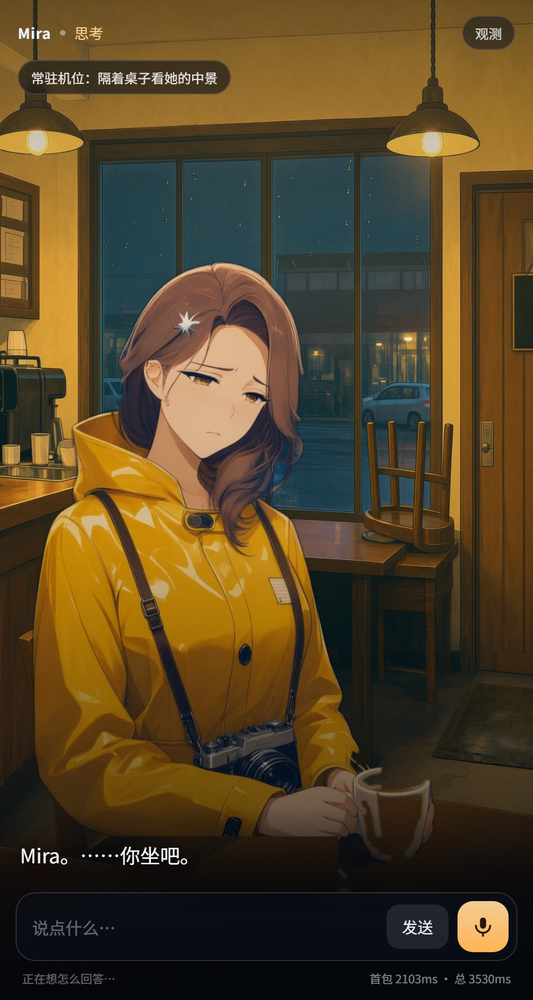

# Mira · 实时互动场景（72 小时实验）

暴雨刚停的夜里，一家即将打烊的咖啡馆。Mira 穿着琥珀色雨衣坐在窗边，似乎在等一个不会来的人。
你可以打字或按住麦克风和她说话，她**会开口（语音 + 字幕）、会变表情、会做动作、会换镜头、会被你这句台词触发一段演出（闪电 / 照片 / 车灯）**；她说话时你随时可以开口打断。

不是聊天列表：整屏都是场景和角色，交互入口只是一条字幕区 + 一个麦克风。



---

## 1. 快速开始

```powershell
# 一条命令：建 venv、装依赖、起服务、开浏览器（首次约 2-3 分钟，之后 <20s）
powershell -ExecutionPolicy Bypass -File .\start.ps1
# 或者双击 start.bat
```

打开 <http://127.0.0.1:8787/>，点「进入场景」。

- **默认自动选择 provider**：`start.ps1` 会先看 8080 上有没有本地模型；没有就用
  `tools\llm\llama\llama-server.exe` 把 **Qwen3.8-4B（Q4_K_M）** 拉起来
  （首次加载 5-15 秒），起不来才退回 **Mock**。
- **真实模型模式**（本地 llama.cpp，OpenAI 兼容接口，无任何云端密钥）：

```powershell
# 也可以手动控制（例如另开一个窗口看模型日志）：
powershell -ExecutionPolicy Bypass -File .\tools\llm\start_llm.ps1
$env:LLM_MODE="llama"; powershell -ExecutionPolicy Bypass -File .\start.ps1
```

- **Mock 模式**（`$env:LLM_MODE="mock"`）：不调用任何模型、不需要网络、不需要 Key，
  剧本按你的话推进，四种状态、6 种表情、8 种动作、镜头/环境切换、3 类事件演出全部可复现。
  它是**同一条代码路径**（同一个流、同一套指令、同一个前端状态机），只是把「文本生成」换成剧本，
  用来保证在别人机器上也能零依赖看到完整流程。

页面右上角「观测」可以在运行时切换 provider、注入故障、查看状态事件与耗时。

| 地址 | 用途 |
| --- | --- |
| `/` | 互动场景 |
| `/debug` | 观测页：一次互动的状态事件、耗时、错误 |
| `/api/health` | 健康检查 |

> 麦克风需要 `localhost` 或 https 环境（浏览器安全上下文），本机 127.0.0.1 满足。

---

## 2. 题目要求 → 本实现

| 题目要求 | 实现 | 位置 |
| --- | --- | --- |
| 场景为视觉主体、非聊天列表 | 全屏场景 + 角色 + 字幕 + 输入坞，无消息气泡 | `app/static/index.html` |
| 移动端优先、桌面正常 | 560px 竖屏居中卡片，`dvh` + 安全区适配 | `style.css` |
| 待机/倾听/思考/说话 四状态 | `data-state` 驱动角色微动、指示灯、文案 | `app.js:setState` |
| 文字 + 麦克风输入 | 输入框 / 按住说话或轻点录音（`MediaRecorder` → `/api/stt`），带录音计时、电平、取消 | `app.js:startMic` |
| 语音回复 + 同步字幕 | 逐句 TTS，音频播放时才把该句推到字幕；句间按标点插 80–420ms 气口 | `main.py:tts_worker` / `app.js:gapAfter` |
| 多轮连续互动 | 会话保持 history + 观众事实记忆 + 反重复台账，剧情节拍随对话推进 | `main.py:Session` |
| 语音打断 | 按下麦克风 = 本地停播 + 清空队列 + 服务端 epoch+1 | `app.js:interrupt` / `main.py` |
| 被打断的回复立即失效 | 每个事件带 `seq`，客户端丢弃旧 seq；服务端 epoch 失效后停止下发 | 见 §4 |
| 结构化角色/场景指令 | **首行 JSON 指令 + 换行 + 台词**，5 个维度、白名单收敛 | `cards/*/card.yaml` / `app/main.py:header_probe` |
| 一份数据三处用（卡包） | 卡包同时驱动提示词、指令枚举、客户端素材清单 `/api/card` | `cards/mira_cafe/card.yaml` / `app/cards.py` |
| ≥3 种情绪 | neutral / smile / worried / surprised / thinking / listen，6 张独立表情贴片 | `app/static/assets/char/` |
| ≥2 种非说话动作 | look_window / look_door / sip_coffee / check_phone / lean_in / show_photo / stand | `app.js:applyAction` |
| ≥1 次背景/镜头/环境变化 | 镜头推近（整舞台 transform，不重绘素材）、灯光转暗（环境叠加，收尾拍固定触发） | `app.js:applyScene` |
| ≥1 个由对话触发的视觉事件 | 雷闪 / 照片演出 / 末班车，**内容触发 + 剧情跳转**（见 §5.2） | `main.py:finalize` / `app.js:triggerEvent` |
| 一种多模态表现能力 | **程序合成的演出层**：闪电补光 + 瞬时滚雷（WebAudio）/ 照片静帧推近 / 车灯横扫 | `app.js:triggerEvent` `rumble` `carSweep` |
| 素材加载/结束/打断处理 | 静帧「加载中」徽标、`onload` 收层、打断即清 `src`（原来的 MP4 路径已删除） | `app.js:showStill` / `hideCinema` |
| 生成中状态与失败处理 | 「静帧加载中…」徽标、失败降级为暗角+徽标、闪电/车灯天然不需要素材 | `app.js:degradeEvent` |
| 模型超时/断线/失败反馈 | LLM 首 token 14s/整体 35s 超时、TTS 失败降级、注入故障可复现 | `main.py` / 观测面板 |
| 快速连续输入不播失效回复 | `seq`/epoch 双保险（见 §4） | `app.js:sendTurn` |
| 无密钥可体验 | Mock 模式（无模型权重时自动退回） | `app/providers.py:MockLLM` |
| 一条命令启动 | `start.ps1` / `start.bat`（自动拉起本地模型，失败退回 Mock） | 仓库根目录 |

---

## 3. 系统结构

> 进程级拓扑图（可交互，含边界与能力/边界清单）：[docs/topology.html](docs/topology.html) ·
> 结构审查与待补能力：[docs/ARCHITECTURE_TOPOLOGY.md](docs/ARCHITECTURE_TOPOLOGY.md)

```
① 内容层：卡包（数据驱动，一份数据三处用）
  cards/<card_id>/card.yaml
    ├─ character：人设 / 外形 / 事实清单 / 边界 / 声音参数
    ├─ scene    ：时间、天气、机位 POV、打烊细节、环境音
    ├─ beats[]  ：导演动机（goal / allow / forbid / 话题推进阈值 / 兜底台词）
    ├─ directives：emotion / action / scene / effect / event 五个枚举 + default
    ├─ tts      ：情绪语气 + 句级韵律规则 + 句间停顿
    └─ assets   ：贴片 / 场景板 / 插入图 / 静帧演出的资源清单
  app/cards.py：加载 + 校验（枚举、引用、资源路径、版本号）+ 生成客户端快照
        │  三处消费：① 提示词渲染  ② 服务端指令白名单  ③ GET /api/card → 前端素材路径
        ▼
② 服务端：FastAPI（单进程，一键启动）
  app/main.py
    ├─ Session：seq（轮次）、epoch（打断代）、history、beat（节拍）、user_facts、recent
    ├─ 编排：run_turn = ASR 文本 → ContextComposer → LLM 流 → Parse → Guard →
    │        BeatDirector → TTS 并发合成 → NDJSON 下发
    ├─ 闸门：sanitize（白名单）/ pin（本拍固定表现）/ guard（节拍）/ dedupe（不重播事件）/
    │        keyword_event（内容触发兜底）
    ├─ providers：MockLLM / LlamaLLM（llama.cpp）/ edge-tts / faster-whisper
    └─ /api/card /api/session /api/turn /api/interrupt /api/stt /api/events
        ▼
③ 客户端：原生 HTML/CSS/JS（移动端优先，不持有剧情真相）
  app/static/
    ├─ 场景层：背景板（固定静帧）+ 角色贴片（alpha）+ 雨痕/闪电/暗场/颗粒
    ├─ 演出层：静帧照片（推近）+ 闪电补光 + 车灯横扫 —— **没有 <video>**（2026-10-20 全删）
    ├─ 状态机：idle / listening / thinking / speaking
    ├─ 音频：Web Audio 环境音（程序合成雨声底噪）+ 逐句 Audio 队列 + 句间气口
    └─ 输入：文本 + 按住说话 / 轻点录音（MediaRecorder + 自适应 VAD）
```

一次 turn 的事件流（NDJSON，每行一个 JSON，均带 `seq`）：

```
state(thinking) → turn_start → directive → subtitle_partial… →
state(speaking) → audio(第1句) → … → reply → done
```

指令**先于**台词和音频发出：`emotion` 到得早，第一句 TTS 就能用对应语气合成，
表情/镜头也和第一句语音同时发生，而不是等整段说完才知道她是什么情绪。
`directive` 事件里带 `fixes`（白名单收敛、节拍闸门、关键词兜底各自的说明），观测面板可见。

---

## 4. 语音与打断：为什么这样做

### 4.1 打断链路（按住说话即打断）

1. `pointerdown` 麦克风 → **先在本地** `stopPlayback()`：暂停当前 `Audio`、清空待播队列、
   取消浏览器语音、收起演出层并清空字幕 —— 这一瞬间画面上已经"停下"。
2. 立刻 `POST /api/interrupt`：服务端 `epoch += 1` 并 `cancel()` 正在跑的 turn 协程。
3. `getUserMedia` 开始录音，状态切到「倾听」。
4. 松手 → `/api/stt` → 转写文本 → `POST /api/turn` 作为新一轮（新 `seq`）。

### 4.2 迟到的响应为什么不会覆盖新状态

双保险：

- **客户端**：全局 `S.activeSeq`。任何事件 `ev.seq !== S.activeSeq` 直接 `continue`。
- **服务端**：每个 turn 捕获自己的 `epoch`；`emit()` 发现 `epoch` 已失效就抛 `TurnCancelled`，
  协程立即结束，不会再有新事件写进流。

所以「上一轮迟到的网络响应」既不会被发出，也不会被渲染。

### 4.3 麦克风：为什么是「按住说 + 轻点说」两种手势，不用纯自动 VAD

- **按住说话**给用户一个**明确的打断意图**，不需要区分"嗯/对"这类附和音和真正打断（这是题目
  可选扩展里最难的部分，本机没有可靠的 AEC，容易让角色听到自己的声音）。
- **轻点一下**也能录：说完停顿 1.15s 自动发送，再点一下立刻发送。很多人第一次用会"点一下然后
  说话"，如果只支持按住，他们会以为话筒坏了。
- 录音时界面上有**计时、电平条、取消**（`#recBar`）。这三种东西比任何提示文案都管用：
  用户能自己判断"我有没有被听见"。

这一版改之前，实测踩过三个会让用户认为「话筒无法说话」的坑（都修了，注释写在
`app.js` 的麦克风段落里）：

1. 只在 `audio/webm;codecs=opus` 上建 `MediaRecorder`：Safari / 部分 Edge 直接抛
   `NotSupportedError`，而构造代码没有 try，**录音机根本没建起来**，界面还停在「倾听」。
   现在按 `webm/opus → webm → ogg/opus → mp4 → aac` 逐个探测，并且构造也包了 try/catch。
2. 静音自动发送的阈值写死成 `rms > 0.012`：笔记本内置麦 + 强降噪时永远到不了，
   `speechAt` 一直是 0 → 「说完等半天没反应，一直录到 15s 上限」。现在先估底噪、
   阈值取 `max(0.006, floor×2.4)`，并且要求检到足够多语音帧才允许自动发送。
3. 她说完最后一句时字幕被清空、这一轮又没有任何可见反馈 → 用户以为「刚才什么都没发生」。
   现在字幕保留到最后一句，未识别/太短/被拒/被占用都有具体提示。

---

## 5. 角色 / 场景指令协议

**协议 = 第一行一个 JSON 对象，换行之后才是要说的台词**（模型被 system prompt 要求严格这么输出）：

```json
{"emotion":"worried","action":"look_window","scene":"cafe_night","effect":"rain","event":"none"}
这雨下了一整天，我都有点忘了它停下来的样子。
```

为什么把指令放在**开头**而不是结尾：流式输出里指令先到 → 服务端在第一个换行处就拿到
`emotion`，于是**这一轮的第一句语音**就能用对应语气（rate/pitch/volume）合成，表情和镜头
也和第一句语音同时切换。放结尾的旧格式（`###DIRECTIVE###` + JSON）仍被兼容，作为模型
不听话时的降级路径；此时 `directive` 事件标 `parsed:false` 并记录一条 fix。

服务端 `header_probe()` 按**括号配对**扫描首行（不是 `split("\n")[0]`），JSON 没闭合前
一个字都不送去 TTS；`finalize()` 按顺序做四件事：

1. `sanitize_directive()` **白名单收敛**：不在枚举内的值回退默认，写进 `fixes`；
   （小模型会自创 `emotion:"listening"`，这步把它收敛成合法值而不是报错）
2. **本拍固定表现 `pin`**：收尾拍必须出现「灯光转暗」的环境变化，不交给 4B 随机决定；
3. `guard_story()` **节拍闸门** + **事件去重**：还没到的事件拦下，已经演过的事件不再重播；
4. `keyword_event()` **内容触发兜底**：4B 小模型经常只给 `event:"none"`，若用户这句话里
   确实出现了「雷 / 照片 / 末班车」触发词、节拍允许、且这个事件还没放过，就补一个
   —— 事件权限仍然绑在台词内容上，不是计时器。

### 5.1 让 4B 模型「像在对话」而不是「在背台词」

第一版提示词把「1–2 句、不超过 45 字、情绪藏在动作里」写死，4B 模型于是把每一轮都做成
一句写景短诗：用户问「你是在等谁」，它答「这雨，好像下得挺久的」——技术上合规，体验上是
**答非所问**，整段互动像在念固定台词。这一版改了五件事：

1. **回答纪律**：「先回答，再延伸。对方问什么，第一句必须针对那个问题做出反应；
   不想说就否认、反问、或一句话挡回去，**不允许**用天气/景物/比喻代替回答」。
2. **具体化**：要求给物件、给时间、给数字（「十点半」「过期的 Portra 400」「第四十七个晚上」），
   一轮最多一个比喻。
3. **反重复台账**：把最近 5 句角色台词贴回提示词，明确要求「换一种说法」；
   llama.cpp 侧再开 `repeat_penalty`（回看上下文，压跨轮逐字复读）。
4. **观众记忆**：从用户这句话里抽「他叫什么 / 为什么这么晚 / 被雨淋了」这类事实，
   下一轮写进提示词里——被记住一次比多一句华丽台词更能让人觉得「这是活的」。
5. **空台词兜底**：4B 偶尔只吐首行 JSON 就停（本轮实测真的会发生），此时用本拍兜底台词，
   并在观测面板记一条 fix，不假装是模型说的。

**后来补的一条（同日下午）：真正的问题不是模型太小，是我让它同时干了四份工。**
上面五条都还在，但转折点是新增 `app/director.py` **导演层**：意图判定、这一轮要传达的
事实骨架、机检标准（必须出现的名字 / 本轮禁用词 / 字数 / 跨轮复读）全部放进确定性代码，
模型只负责把已定的内容说成她的口吻。于是默认档从 25B 换回 **4B**：单轮生成 0.4–0.6s，
关键轮（「你还记得我叫什么吗」）走「生成 → 机检 → 重写一次 → 确定性兜底」，
固定六轮脚本 **0 违规**，而 25B 在同一脚本上是 4–7s 一轮。
详见 [`docs/SMALL_MODEL_PLAN.md`](docs/SMALL_MODEL_PLAN.md)。

**再补一条（2026-10-20 晚）：光有提示词纪律还不够，必须有机检。**
用户反馈「答非所问，撑不起一段对话」，查下来是结构问题：旧意图规则是「一个意图一份
固定台词」，没表示**问的是哪件事**（「为什么这么晚还在」和「你为什么不去找他」落到同一句）；
default 轮根本没有 content；而机检只覆盖 2 个关键轮，其余轮次错了也拦不住。
现在的结构是：

1. **问句槽位**取代意图类别：先抽「这句话问的是哪件事」（号码 / 回去方式 / 照片 / 咖啡 /
   怕不怕 / 为什么不去找 / 是不是骗 / 后来呢 / 打算怎么办…），每个槽位自带
   `content`（该说的事实）+ `anchors`（回答必须点到的话题词）+ `fallback`（对题兜底）。
2. **首句闸门**：利用「TTS 本来就要等到句号才切句」这一点，**第一句完整时先校验再送 TTS**，
   成功路径 0–1ms 额外延迟；答不在题上就先等第二句，两句都不过才丢弃整段重写一次，
   再不过用对题兜底。闸门判据是可机检的：话题锚点 / 硬禁词（「阿岸」）/ 英文词 /
   与最近 3 句的整句与开头半句复读 / 旁白客服腔。
3. 每次 turn 的 `done` 事件里带 `gate.{checks,rewrites,ms,wait_ms}` 与 `first_text_ms`，
   谁都能复核「这轮到底答没答对、闸门有没有动作」。

> 结构、数据流、判据、before/after 真实台词与数字，全部写在
> **[`docs/DIALOGUE_LOGIC.md`](docs/DIALOGUE_LOGIC.md)**；取证数据在
> `docs/review/dialogue/`（12 句固定剧本 × before/after，含逐轮原始记录与报告）。

### 5.2 剧情推进：内容触发，而不是计时器

- **用户问到哪一拍的话题，剧情就跳到哪一拍**（`beat_jump`）。用户一进门就问「能看看那张
  照片吗」，她不会用一句废话糊过去，而是**当拍就掏出照片**并播放照片演出——这既符合题目
  「视觉事件必须由对话内容触发」，也让用户感到「我说的话真的改变了剧情」。
- 用户不问时，靠 `min_turns / min_hits / max_turns` 兜底往前走，保证 3–5 分钟里剧情一定会收尾。
- 每个事件的「最早节拍」写在卡包里；现在照片/末班车都是 0，因为**挡住的代价（答非所问）
  比提前演的代价大得多**。

| 字段 | 取值 | 前端表现 |
| --- | --- | --- |
| emotion | neutral / smile / worried / surprised / thinking / listen | 换角色贴片（叠加在固定背景板上，背景不动） |
| action | idle / look_window / look_door / sip_coffee / check_phone / lean_in / show_photo / stand | 动作贴片 + 镜头微推；几秒后回到当前情绪贴片 |
| scene | cafe_night / window_close / lights_dim | 整舞台镜头变换（不重绘素材）或暗场叠加 |
| effect | rain / thunder / none | 雨后的屋檐滴水环境音、闪电补光 |
| event | none / thunder / photo_reveal / last_train | 程序合成演出（闪电补光 / 照片静帧推近 / 车灯横扫），失败降级为最简演出 |

`fixes` 让「模型不听话」可观测：白名单收敛、节拍拦截、事件去重、关键词兜底、空台词兜底
各有说明，观测面板能看到。

### 5.3 表现指令：框架决定 + 用台词做二次校正（2026-10-21）

情绪/动作**不再让 4B 在首行 JSON 里自己选**，也不只是「意图查表」——查表看不见这一轮
到底说了什么，于是会出现「表里要掏照片、台词里根本没提照片」这种动作和台词互不相干的情况。
现在的链路是两段：

1. **L0（0ms，拿到判题就发）**：`app/director.py` 的 `_EMOTION_BY_INTENT` /
   `_ACTION_BY_INTENT` 按意图给出表情与动作，客户端不必等模型首字就能换脸/演动作；
2. **第一句台词落地后（~0.7–1.2s）**：`director.dialog_fix()` 用**真实台词**再校正一次，
   规则写在卡包 `cards/mira_cafe/card.yaml` 的 `dialog_fix:` 段（数据，不是硬编码），
   每个字段（emotion / action）取第一条命中的规则，双向生效：
   - 台词提到照片 / 「拿给你看」/「内袋」→ 允许并倾向 `show_photo`；
   - 表里要掏照片但台词没提照片 → **降级**成 `look_window`（不许无缘无故掏照片）；
   - 台词提到雨/窗外 → `look_window`；门口/老板娘 → `look_door`；手机/电话 → `check_phone`；
     咖啡/杯子 → `sip_coffee`；该走了/关门/起身 → `stand`；
   - 她自己**说话时**一律不允许 `listen` 表情（这是上一轮反馈里「她说着话却在倾听」的兜底漏点）。
3. 校正是**增量事件** `directive_patch`（只带 emotion/action），客户端立即应用；
   `done.dialog_fix = {n, fixes, emotion, action}` 与 `logs/turns.jsonl` 的 `dialog_fix_n` 留痕，
   观测面板的「台词校正」列显示每轮改了几次。

实测（10 轮固定台词，`tools/qa/dialog_fix_probe.py`）：**4/10 轮触发校正**，
其中一次是「表里 show_photo → 台词里没提照片 → 降级 look_window」，
一次是「表里 lean_in → 台词提到电话 → check_phone」。逐轮记录见
`docs/review/dialogue/dialog_fix_after.json`。

---

## 6. 多模态表现：由台词触发的演出（无视频）

> **2026-10-20：全部视频已删除。** 原来有 4 段 MP4（`thunder / photo_reveal / last_train /
> idle_loop`），由 AniSora 从另一套机位生成。问题很具体：它们的机位、光线、景深和底板
> 不是同一场戏，插进来那一秒等于"背景换台"，而且人物比例对不上。删掉之后演出改成
> **程序合成 + 一张静帧**，三个事件各自的物理都不一样：

| 事件 | 触发 | 表现 | 实现 |
| --- | --- | --- | --- |
| `thunder` | 台词提到雷/闪电；或用户被雷声吓到 | 三段冷蓝补光（`@keyframes lightning`）+ 低频滚雷 | `doFlash()` + `rumble(1.0, 1.6)` |
| `photo_reveal` | 剧情第 4 拍后提到照片/相机 | 角色换 `show_photo` 贴片，照片静帧推近 + 徽标 | `showStill(polaroid)` |
| `last_train` | 提到末班车/打烊/要走 | 一条光带从窗外横扫 2.6s + 远处低频轰鸣 | `carSweep()` + `rumble(0.5, 2.8)` |

> 演出仍然是「插入镜头」：`photo_reveal` 会整屏进 cinema 层，结束后回到常驻舞台；
> 常驻舞台本身永远是「背景板 + 角色贴片」两层，**不依赖任何视频**，删视频不影响待机画面。

播放细节（题目要求的三件事，在无视频之后仍然成立）：

- **加载**：`showStill` 先显示「静帧加载中…」徽标，`onload` 才淡入并做 6s 推近。
- **结束**：定时收层、清 `src`、回到常驻场景。
- **打断**：`hideCinema()` 立即清 `src` 与定时器，未播完的演出不会继续。
- **失败降级**：`degradeEvent()` → 闪电只补光、照片退成暗角 + 徽标，绝不黑屏；
  观测面板的「演出降级」按钮可以随时注入这个故障。

> 为什么不再去生成替代视频：这类片段必须和底板同机位、同光线、同景深才不"跳台"，
> 而程序合成已经能把"画面变了、而且是因为你这句话变的"说清楚，成本是 0 素材、0 授权、0 加载。

---

## 7. 模型与素材

> 素材审核入口：**[docs/ASSETS_REVIEW.md](docs/ASSETS_REVIEW.md)**（哪张图在哪、哪些在用、哪些是废弃残留、已知问题）。
> 第五轮重画（Krea-2 Turbo / char_v8 + plate_v8 + 动作中间帧序列）的验收记录与切换方式：
> **[docs/ASSETS_V8.md](docs/ASSETS_V8.md)** —— 默认仍走 v7，`?assets=v8` 试看。

| 用途 | 方案 | 说明 |
| --- | --- | --- |
| 场景背景板 | **Qwen-Image 2.1**（t2i 工作流，本地 ComfyUI 0.37） | 864×1536 竖屏、25 步、`euler+simple`、CFG 1.0（蒸馏模型，CFG 必须 1.0） |
| 角色 / 表情 / 动作 | **Qwen-Image 2.1 参考图编辑工作流** | 场景图 + 角色参考图两张输入把人物放进场景，再逐条指令派生 11 个表情/动作 |
| 角色抠像 | rembg `isnet-anime` + 连通域清理 | 得到带 alpha、与背景板同机位的角色贴片 |
| 演出（已删视频） | ~~AniSora V3.1（Wan2.1-I2V-14B fp8）~~ → 程序合成 + 一张静帧 | 原来生成 4 段 MP4，但机位/光线和底板不是同一场戏，2026-10-20 全部删除；现在闪电/车灯用 CSS + WebAudio 合成，照片用 `insert/polaroid.jpg` 推近 |
| 对话 | Mock 剧本 / Qwen3.8-4B（llama.cpp，OpenAI 兼容） | 真实模式完全本地，无云端密钥 |
| TTS | edge-tts `zh-CN-XiaoxiaoNeural`（rate +6%，pitch -2Hz） | 无 Key；mp3 按文本哈希缓存，重复台词 0 开销 |
| STT | faster-whisper `small`，CPU int8，VAD | 热身后 2.2s 语音约 2.2s 转写；`WHISPER_SIZE=base` 可降到 0.8s |

### 7.1 两个专门工作流，配合使用

关键原则：**场景是固定一层，角色是另一层**。先分别生成，再合成；不再「一张图里同时有场景和人物」。
第一版用 SDXL + img2img 做「同构图表情差分」，问题是 img2img 会把背景一起重绘（人物一换，灯和窗也跟着变），
所以改成了下面这条链路：

**① 场景工作流（Qwen-Image 2.1 文生图）**

空咖啡馆背景板，9:16（864×1536，与手机竖屏一致），提示词里明确 `empty, no people`。
用的是 Qwen-Image 2.1 的原生节点图：

```
UNETLoader(qwen_image_2.1_int8_convrot) + CLIPLoader(type=qwen_image) + VAELoader
→ TextEncodeQwenImage21(prompt, negative, cfg 1.0) → EmptyLatentImage(864×1536)
→ KSampler(steps 25, cfg 1.0, euler/simple) → VAEDecode → SaveImage
```

**② 角色工作流（Qwen-Image 2.1 参考图编辑）**

同一个模型的编辑路径（`TextEncodeQwenImage21` 接收参考图 → reference latents），按两步走：

- **把角色放进场景**：参考图 1 = 背景板，参考图 2 = 角色立绘；指令是「把图 2 的女孩放进图 1 的吧台后面，
  保持脸、雨衣、发夹，匹配灯光，不要改房间和镜头」。人物和场景由此在同一次生成里对齐机位。
- **派生整套动作神态**：以上一步合成好的帧为参考图，逐条指令只改「表情 / 动作」：
  `keep the same character, same outfit, same pose and same camera framing; <surprised expression>`
  等 11 条（6 表情 + 5 动作）。因为每次都以同一张 hero 帧为参考，人物不会像 img2img 那样越改越飘。

**③ 抠像与合成**

每帧用 rembg `isnet-anime` 抠出角色，去掉悬空的小连通块（比如头顶的吊灯），得到与背景板
**同一机位、同一尺寸**的 RGBA 贴片；合成验证的像素差在人物区域约 8/255（验证脚本会打印）。
前端把背景板（`plate/cafe_night.webp`）和角色贴片（`char/*.webp`）分开加载，换表情/动作只换上层。

```powershell
# 素材生成（需要 D:\ai\qwen-image 的 ComfyUI 0.37 + 本地 Qwen-Image 2.1 int8）
python tools\gen\qwen_workflow.py pipeline    # 旧链路：场景 → 合成 → 背景板 → 11 个表情/动作
python tools\gen\gen_turn.py                  # 新链路：中近景底板 → 合成 Mira → 11 状态（见 §7.3）
python tools\gen\cut_turn2.py                 # 用「合成帧 − 干净底板」求 alpha
python tools\gen\integrate_turn.py --grade 0.6  # 统一夜景调色 + 压 webp + 备份旧素材
```

`integrate_turn.py` 会把 `assets/turn/` 验收通过的底板与 11 张 RGBA 贴片压成 webp 写进
`app/static/assets/`，旧素材整体备份到 `assets/legacy/<时间戳>/`，一条命令可回滚；
`--grade` 是**底板和贴片共用**的同一套调色，这是避免"人物和背景两张皮"的关键一步。

相关参考（用来选型/对齐官方节点图，不依赖任何在线 API）：

- Comfy Organ 官方工作流库：[Qwen-Image-Edit 工作流](https://comfy.org/workflows/model/qwen-image-edit/)、[全部工作流](https://comfy.org/zh/workflows/)
- 社区 Qwen-Image 2.1 工作流（含节点版本要求与 CFG=1.0 的原因）：<https://github.com/foprc/qwen-image-2.1-comfyui-workflow>
- Qwen-Image 2.1 ComfyUI 重打包权重：<https://huggingface.co/Comfy-Org/Qwen-Image-2.1>
- 透明图层生成的另一条路线（对重训 SDXL 模型兼容性一般，故未采用）：[ComfyUI-layerdiffuse](https://github.com/huchenlei/ComfyUI-layerdiffuse)
- 角色绑定/实时驱动的后续方向：[Inochi2D](https://github.com/Inochi2D/inochi2d)（开源 Live2D 替代）

### 7.2 为什么用「场景工作流 + 角色工作流」而不是一张图

| 做法 | 换表情时背景 | 换角色时场景 | 机位一致性 |
| --- | --- | --- | --- |
| 单张全帧图（第一版） | 背景一起重绘，灯/窗会抖 | 整张场景跟着变 | 靠 seed + img2img 近似，不稳定 |
| **背景板 + 角色贴片（当前）** | **背景像素不动** | **只换贴片，场景不动** | 贴片与背景板同尺寸同机位，几何上对齐 |
| Live2D / Inochi2D 绑定 | 不动 | 需重做绑定 | 最灵活，但 72h 内做不出可用绑定 |

### 7.3 素材返工：为什么第一版「不像那家店」

第一版素材做完后，实际看着有三类硬伤（也是我自己给这一版的差评）：

1. **机位穿帮**：顾客是坐在桌边的客人，画面却给了「吧台制作区内部」的视角，她站在吧台后面
   对着镜头笑——像店员迎客，不像在等人。
2. **天气错了**：应该是「暴雨刚停」（湿地面、玻璃水痕、屋檐滴水），画面里却是正在下暴雨。
3. **打烊的细节没有**：没有客人走后没收的餐具、没有吧台水槽里待洗的杯子、没有翻到桌上的椅子、
   没有灭掉的 OPEN 灯牌；吊灯全亮着。
4. **角色道具丢了**：银色星星发夹不明显、相机根本没画出来、神态不对（该焦虑在等人，不该是笑脸）。

原因不是「模型不够强」，而是**五层资产被挤进了一条 prompt**：身份 / 道具 / 表情 / 场景 / 机位。
一次生成只能稳住其中两三层，剩下的必然崩，而且每次崩的位置还不一样。其中「机位穿帮」的机制
很具体：prompt 里写了洗碗池、待洗杯具这些**当前机位根本看不见**的道具，模型为了满足 prompt，
只能把机位挪到看得见它们的地方。

修法（细节见 [docs/research/turnaround_workflow.md](docs/research/turnaround_workflow.md)）：

- **机位-道具分配表**：A 机位（客人视角越过桌面）只准写这个机位看得见的打烊细节，
  洗碗池留给反打机位；
- **场景板先定稿、再合成角色**：先出「空的、雨后、打烊中」的 plate 并逐项过验收清单，
  再把 Mira 合成进窗口那个座位；
- **三视图当身份锚**：正/侧/背逐角度出图，只用来锁「脸/发型/发夹/雨衣/相机」，
  不用一张 sheet 硬凑；
- **表情只裁头肩单改**：每次回锚图派生，绝不链式往下改（否则越改越飘）；
- **道具用位置绑定 + 局部重绘**：发夹、相机这种小物件靠局部 crop 重绘和贴片兜底，
  不指望整图重生成时它自己长对。

> 状态：**第一轮返工已完成并上线**（2026-10-19）。
> 新素材在 `assets/turn/`，经 `tools/gen/integrate_turn.py` 统一调色后替换 `app/static/assets/`，
> 旧素材备份在 `assets/legacy/<时间戳>/`。这一轮做完的：客人视角隔桌中近景、雨后（无雨幕）、
> 打烊细节（未收餐具 / 待洗杯 / 翻起椅子 / 灭灯牌）、两盏吊灯、琥珀雨衣 + 星形发夹 + 相机齐全、
> 11 个形态同一人同机位。**遗留**：发夹是"星芒"不是清晰的五角金属星；11 张里 4 张 25 步、
> 7 张 16 步，锐度略有差异。
>
> **2026-10-20 更新**：原来还有三段 AniSora 事件片段和一段待机循环，因为机位/光线/景深和
> 底板不是同一场戏（插进来一秒就是"背景换台"），用户明确要求删除，**已全部删掉**，
> 演出改为程序合成（见 §6）。这条也算把下面的历史问题彻底关掉：
> 旧版 `idle_loop.mp4` 是**吧台视角 + 正在下雨**的循环视频，换底板后它仍盖在场景板上，
> 导致"新底板 + 旧视频"同时出现（下着雨、吧台在右边）。现在没有视频层，这个问题不可能再出现。

素材全部自制（AI 生成 + 本地推理），无第三方版权素材；未使用任何私有 API Key。

---

## 8. 关键技术选择与取舍

1. **不用 Live2D / Rive / Spine，用「背景板 + 角色贴片 + 程序合成演出」**
   Live2D 需要拆分图层与绑定，72 小时内做不出可用的二次元角色；Rive/Spine 同理。
   改为分层舞台：场景是固定的一层背景板，角色是带 alpha 的贴片，表情/动作只换贴片，
   镜头变化只对整舞台做 transform —— 背景板一个像素都不动。这正是第一版踩过的坑：
   单张全帧图 + img2img 差分会把背景一起重绘，人物一换，灯和窗也跟着变。
   动态感由**程序合成的演出**补足（闪电补光 / 车灯横扫 / 照片静帧推近），不再依赖视频。
   代价照实说：一层贴片做不了点头、侧倾、呼吸时肩膀的真实形变——这是这条路线的天花板。
2. **不做端到端语音模型，用 STT + LLM + TTS 三段式**
   端到端语音模型（如 Moshi）本机没有可用的中文权重，且难以插入"打断即停"的确定性控制。
   三段式每一步都可中断、可降级、可观测，符合题目对打断的严格要求。
3. **NDJSON 单流而不是 WebSocket**
   一次 turn 的所有事件必须**严格有序**且能整体取消；HTTP 流 + 轮次 `seq` 天然具备
   "这条流属于哪一轮"的语义，取消只需 epoch+1，比维护双向通道状态更简单。
4. **打断 = 本地先停 + 服务端取消**
   只靠服务端取消会让音频继续播 100-300ms；只靠本地会让服务端继续烧 TTS。两边都做。
5. **Mock 优先**
   面试演示最大的风险是网络/额度/环境。Mock 模式是**真实代码路径**（同一套流、同一套指令、
   同一套前端状态机），只把「LLM 文本生成」换成剧本，因此能保证演示零失败，也方便自动化测试。
6. **演出的加载/结束/打断/降级仍然完整实现，只是素材从视频换成了静帧与程序合成**
   题目要求"使用视频时处理加载、结束、打断"，现在没有视频了，但这四件事一条没少：
   静帧有加载中徽标/`onload` 收层/`hideCinema()` 即清 `src`/失败退成暗角 + 徽标。
   为什么不再去生成替代视频：实时生成 3 秒片段要 1–3 分钟，与互动节奏冲突；离线预生成
   又必须和底板同机位同光线才不"跳台"，那还不如用 CSS/WebAudio 合成——0 素材、0 加载。

---

## 9. 观测、降级与测试

- 页面「观测」面板：provider 切换、故障注入（LLM 超时 / TTS 失败 / TTS 变慢 / 演出降级）、
  实时事件流水、首包与总耗时。
- `/debug`：独立观测页，读取 `/api/events/<session>`，展示 turn 耗时、错误、provider 健康。
- 降级链：TTS 失败 → 字幕 + 浏览器 `speechSynthesis`（可关）；演出降级 → 闪电只补光、
  照片退成暗角 + 徽标（不黑屏）；LLM 超时 → 错误提示 + 可重试，不打断已完成的画面状态。
- 自动化测试：

```powershell
# 先启动服务，然后：
.\.venv\Scripts\python.exe tools\qa\api_test.py      # 17/17：流/指令/打断/STT/卡包快照
.\.venv\Scripts\python.exe tools\qa\layers_test.py   # 3/3：换表情/换动作只改角色层，背景零变化
.\.venv\Scripts\python.exe tools\qa\mic_test.py      # 按住说话：Chromium 假设备喂 WAV
.\.venv\Scripts\python.exe tools\qa\mic_tap_test.py  # 轻点一下 + 停顿自动发送（"话筒坏了"那条路径）
.\.venv\Scripts\python.exe tools\qa\chat_probe.py    # 对话质量探针：12 轮固定台词，逐轮打印回复/指令/节拍/耗时
.\.venv\Scripts\python.exe tools\qa\shots.py         # 真机截图：开场/待机/事件/观测面板
.\.venv\Scripts\python.exe tools\qa\record_demo.py   # 重录 3-5 分钟演示（见 §14）
```

- `api_test.py`：turn 事件完整性、指令枚举收敛（枚举从 `/api/card` 读，不在测试里硬编码）、
  关键词触发事件、打断后不再发 `done`、打断后新 turn 的 seq 递增、STT 中文转写。当前 **17/17 通过**。
- `layers_test.py`：驱动真实页面后断言分层不变量 —— **换表情/换动作时，角色 alpha 之外
  只变了 0.08% / 0.02%**（阈值 1.5%），镜头变换作用在同时包住背景板和角色贴片的 `.stage` 上。
  这一版把断言从「整帧变化 < 2%」改成「角色 alpha 之外的变化」：11 个状态是逐张生成的，
  她身上的明暗本来就会有细微差别，那属于角色层；被要求的其实是**房间一个像素都不许动**。
- `chat_probe.py`：改提示词/卡包之后用它对比「回复是不是在真的接话、有没有复读、节拍推进对不对」。

---

## 10. 已知问题

1. STT 在 CPU 上约 1x 实时（2.2s 语音 ≈ 2.2s），首次调用还要下载/加载模型（约 20s）；
   已用 VAD 裁剪静音，`WHISPER_SIZE=base` 可降到 ~0.8s 但中文标点会漂移（繁体/简体混出）。
2. 打断目前是「按住说话」显式打断；自动 VAD + 回声消除未做（本机无可靠 AEC 设备）。
3. ~~视频片段是离线预生成的固定 4 段~~ → **视频已全部删除**（2026-10-20）。
   演出改为程序合成，好处是不再有"素材和底板不同场"的跳台；代价是**没有真实运镜**，
   闪电和车灯本质是两层 CSS 光效，靠的是"由你这句台词触发"这个因果，而不是画面信息量。
   这一段该记的教训是：插入镜头必须和主场景同机位/同光线/同景深，否则不管多高清，
   观众第一眼读到的都是"背景换台了"。
4. 角色贴片：**2026-10-21 已按"兜帽放下"整体重出 13 张**（保留雨衣，兜帽垂在肩后，
   对齐"进屋躲雨"的设定；旧版是室内戴帽）。配准统一到旧贴片的 bbox（bottom 1426 / cx 431 /
   宽 ≈572，旧 1427 / 431 / 565），所以换贴片不会跳位；头顶比旧图低 ~40px 是去掉兜帽的必然结果。
   逐张 bbox、edge AA 分数与重出参数见 [`docs/review/hood/REPORT.md`](docs/review/hood/REPORT.md)。
   仍然存在：**没有真正的补间中间帧**——动作之间是 80ms 叠化（两张不同剪影的短交叉），
   幅度大的姿势（stand / lean_in）切换时会有轻微重绘位移。
5. 桌面端是**居中取景框**（600px）+ 同一张场景板的模糊余光底图，不是自适应大屏布局。
   题目只要求"桌面端可以正常体验"，这一版满足该要求但不算加分项；
   要做成"桌面独立构图"需要另一套机位，属于两周项（README §12）。
6. Mock 剧本是线性节拍 + 关键词分支，不理解语义；真实模型模式的剧情节拍控制弱于剧本。
7. 单进程内存会话，重启后会话丢失（题目不要求账号系统）。
8. 对话质量：**默认档是 4B（llama.cpp）+ 导演层（`app/director.py`）**。导演层把「这一轮
   说什么」确定化（意图 / 事实骨架 / 机检 / 兜底），模型只做措辞：单轮生成实测 0.4–0.6s，
   关键轮带一次重写和确定性兜底，固定六轮脚本 0 违规。25B（Strata）保留为**对照档**
   （`LLM_MODE=auto`）：它在完全开放、导演层没预设的话题上仍然更强，但那属于「自由发挥的
   上限」，不是这个场景的必需品。详见 [`docs/SMALL_MODEL_PLAN.md`](docs/SMALL_MODEL_PLAN.md)。
9. 4B 会自创枚举值（例如 `emotion:"listening"`）或只输出首行 JSON 就停。前者被白名单收敛、
   后者用本拍兜底台词接住，都会在 `fixes` 里留痕——**不假装是模型说对**。
10. TTS 仍是 edge-tts（在线服务，无 Key 但有网络延迟），**风格 SSML 被服务端 1007 硬拒**（实测，
    详见 `docs/research/tts_voice.md`），情绪只能靠语速/音高/停顿 + 后处理近似。
    已加 `app/tts/` 后处理：去 Edge 自带静音、按标点重插停顿/气口、小房间混响、高频柔化，
    客户端句间停顿归零避免叠加。
    **延迟（2026-10-21 实测，见 [`docs/LATENCY_2026-10-21.md`](docs/LATENCY_2026-10-21.md)）**：
    edge 云端合成「第一个音频块」就要 1.18–1.38s（哪怕两个字），整句 1.86–2.18s，
    网络抖动时 3.5s；本地后处理只占 52–335ms。现在的对策：
    语气词预合成成本地静态音频 → **第一声 p50 277ms / p90 319ms**；
    首句软切 14→8 字让第一句更早开始合成；单句 TTS 超时 12s→**6s**（抖动不再变成"卡 20 秒"）。
    **第一句台词本身仍要 2.4–4.3s**，这是云服务的地板；要真正压到真人反应速度只能换本地流式 TTS。
    要真正「有感情」需要换本地情感 TTS（CosyVoice2 / IndexTTS2，一天级 PoC，见 README §12）。
11. 麦克风没有做回声消除（AEC）：外放时角色可能听到自己的声音，演示建议戴耳机。
12. 场景已按第二轮反馈返工：**去掉前景三个杯子/纸巾**、**去掉窗外乱码霓虹招牌**（Qwen-Image-Edit
    局部重绘，seed 11 最好），并用 alpha 规则清掉贴片底部残留的杯沿/桌面影子；
    验收图 `docs/review/plate_composite_check.png`。
    但它仍是「生成的一家虚构咖啡馆」，不是真实店铺复刻——下一步用真实店铺照片做 ControlNet/img2img。
    她手里的杯子因为是旧构图抠出来的，边缘仍有半透明感（已用 alpha 增益压到可接受）。
13. **4 分钟演示录屏已于 2026-10-21 01:0x 重录**（`production/reports/demo/mira_demo_4min.mp4`），
    对应状态是：兜帽放下版素材 + 语气词先出声 + 台词二次校正 + 桌面/移动两套验收截图。
    录屏脚本 `tools/qa/record_demo.py` 直接驱动真实 UI（Playwright 录页面 + 页面真实音频混流），
    不是事后配音；chapters 见同目录 `chapters.json`。
14. **单卡 12 GB，四个服务抢同一张卡**：app + llama-server(~3GB) + 神经 TTS(~3-4GB) +
    ComfyUI(~7GB, 只出素材时需要)。超了不是变慢，是**退到 CPU**：实测 llama 4.13 tok/s
    （首字 40s+）、ComfyUI 从 2 s/step 掉到 97.5 s/step。
    换句话说「出素材」和「演示」在这台机器上**不能同时进行**，
    启动顺序 / 自检 / 故障对照表见 [`docs/DEMO_CHECKLIST.md`](docs/DEMO_CHECKLIST.md)。
15. **降级曾经是静默的**（已修）：`auto` 链 strata → llama → mock，掉到 mock 时界面照样
    回一句很像样的话，没人知道背后没调模型；决策层的场景门也曾因为「有模型权重、但 venv 里
    没装 torch」而**整条门失效**（`available()` 只看目录，异常又被上层当成"没有决策层"放行）。
    现在 `done` 事件带 `provider`（card/llama/strata/mock）、观测面板「模型」一行随之变化，
    链内每个 provider 的首字预算 9s（`MIRA_FIRST_TOKEN_BUDGET`）超了就换下一个。
    根因、修法和教训见 [`docs/PLAN_v4.md`](docs/PLAN_v4.md) 末节。

---

## 11. 投入时间（大致）

| 阶段 | 时间 |
| --- | --- |
| 读题、技术选型、素材路线 | ~1h |
| 第一版素材（Animagine SDXL 差分 + 场景图）+ 发现「人物一改场景跟着变」 | ~1.5h（含模型下载） |
| 素材链路重做：场景工作流（Qwen-Image 2.1 t2i）+ 角色工作流（参考图编辑）+ 抠像/合成 | ~2h |
| AniSora 推理栈打通与短片生成（含 25GB 权重下载/解包）｜**该产出已于 2026-10-20 删除** | ~1.5h |
| 后端（会话、流、指令协议、TTS/STT） | ~2h |
| 前端（场景、状态机、音频队列、打断、降级） | ~2.5h |
| **返工：自测发现「对话像背台词 / 话筒像坏的」**（回答纪律重写、内容触发剧情、反重复、观众记忆、麦克风三处兼容与反馈、TTS 并发与句间气口、环境音） | ~3h |
| **返工：卡包化**（card.yaml + 校验加载器 + /api/card + 前端素材清单化） | ~1h |
| 素材返工调研（三视图 / 机位-道具分配 / Qwen 编辑路线） | ~1h |
| 录屏、README、AI_USAGE、自动化测试 | ~2h |
| **合计** | **约 18 小时**（其中约 35% 是等模型下载/推理） |

> 说明：返工的两行是这次交付里最值钱的部分——它们是**我自己体验完 Demo 之后推倒重来的**，
> 不是按题目清单交作业。第一版「技术上达标、体验上不达标」，这一点写在 §7.3 和 §10 里。

---

## 12. 如果继续做两周

1. **素材按 §7.3 的分层流水线重做**：plate 定稿 → 三视图身份锚 → 表情只改头肩 → 道具有专门
   的局部重绘通道；4 个机位（桌面/近景/反打/窗外）共用一张平面图做几何约束，避免穿帮。
   这一步做完再补角色 LoRA（现在训等于把错误固化进权重）。
2. **语音体验**：`webrtcvad` / Silero VAD 做自动打断并区分附和音；AEC 去掉回声；
   流式字幕（partial STT + 边说边显示）；把 edge-tts 换成**本地中文 TTS**（延迟可控、
   能给更细的韵律与气声），并用音频驱动口型。
3. **对话质量**：换 Qwen3-8B 或 14B（12GB 上 8B Q4 可跑）提指令遵循；给角色加**工具调用**
   （记忆写入 / 场景事件 / 结束会话），把「靠关键词兜底」升级成模型自己决定演出；
   加一层「台词去重」后处理压复读。
4. **表演系统**：把「贴片」升级成**配置驱动的角色资源包**（表情/动作/口型/视线分层，
   带淡入淡出与优先级队列）；用 **Qwen-Image-Layered** 把一张成品图自动拆成背景/前景/角色图层，
   再用 **Inochi2D** 做骨骼绑定，换表情/动作就不用逐条编辑生成。
5. **演出**：先把"和底板同机位"这件事解决，再谈视频——现在用程序合成顶着，是因为插入镜头
   一旦和自己的场景不是同一场戏，观众只会读到"背景换台"。真要上视频，得先做固定机位的
   平面图 + 同光源控制，或者干脆走实时渲染（WebGL/SDF 角色）而不是 I2V 生成。
6. **工程质量**：Provider 抽象再抽一层（LLM/TTS/STT 各自可热插拔）、会话持久化、
   OpenTelemetry 埋点、Playwright 端到端回归（含打断时序断言）、把 `tools/qa/chat_probe.py`
   扩成「对话质量回归集」。
7. **剧情**：把剧本抽象成数据驱动的剧情图（节点 + 条件 + 演出），支持多分支与结局
   ——卡包已经是这条路的地基。

---

## 13. 第三方与素材来源

- 图像模型：Qwen-Image 2.1（通义千问，ComfyUI 原生节点；生成场景 + 参考图编辑角色）
- ~~视频模型：AniSora V3.1 / Wan2.1-I2V-14B~~（生成的片段已于 2026-10-20 全部删除）
- 抠像：rembg / isnet-anime（MIT）
- 语音合成：edge-tts（Microsoft Edge 在线语音，免费无 Key）
- 语音识别：faster-whisper（Systran/whisper-small，MIT）
- 本地大模型：Qwen3.8-4B（Apache-2.0），llama.cpp 推理
- 前端：原生 HTML/CSS/JS，无框架无构建步骤
- 所有场景板、角色贴片均由上述本地模型生成，未使用第三方版权素材

---

## 14. 演示录屏（3–5 分钟）

> **当前文件：`production/reports/demo/mira_demo_4min.mp4`（2026-10-21 01:0x 重录）。**
> 内容对应当前状态：兜帽放下版素材、语气词先出声、台词二次校正、无视频的程序合成演出。
> 分镜时间点见同目录 `chapters.json`（脚本自动生成，不含后期剪辑）。

录制脚本做三件事：Playwright 驱动真实页面；页面在 `?rec=1` 时把自己播放的每个 `<audio>`
接进 `AudioContext → MediaStreamDestination` 录成音轨；最后用 ffmpeg mux 成 mp4，
**音画同源**，不是后期配音。

本轮分镜（`chapters.json` 里有精确时间点）：

| 时间 | 内容 | 对应交付要求 |
| --- | --- | --- |
| 0:00 | 开始页：场景与角色是视觉主体 | 页面形态 |
| 0:09 | 进入场景：雨后、两盏暖灯、湿街反光 | 待机状态 |
| 0:12 | 文字互动 1–2 轮：她开口、字幕、表情/动作同步（语气词先出声） | 文字互动 |
| 0:34 | 角色状态切换：倾听→思考→说话 | 4 种状态 |
| 0:45 | 提到照片 → 镜头切近景 + **照片静帧推近** | 内容触发的视觉事件 + 多模态 |
| 1:19 | 提到打雷 → 闪电补光（三段闪）+ 低频滚雷 | 同上，第二类事件 |
| 1:29 | 语音互动：WAV 伪装麦克风，走真实 STT 通路 | 语音互动 |
| 1:54 | 她说话时按下麦克风 → **打断**，旧回复作废 | 语音打断 |
| 2:12 | 注入 LLM 超时 → 明确报错且可恢复 | 失败/降级状态 |
| 2:20 | 注入 TTS 失败 → 语音降级为字幕 | 失败/降级状态 |
| 2:29 | 观测面板：provider 切换、故障注入、事件流水、首包/总耗时、台词校正 | 可观测量 |
| 2:30 | 切到 Mock：无需模型/网络/密钥也能完整走一遍 | 无密钥路径 |

