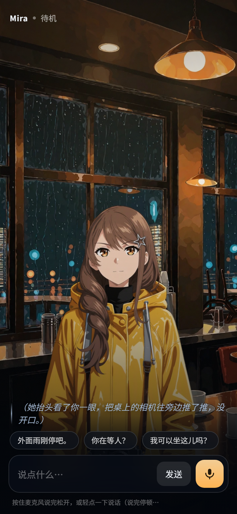

# Mira · 实时互动角色

暴雨刚停的夜里，一家即将打烊的咖啡馆。Mira 坐在窗边等一个人——她的手机从七点起就没电了。

你可以打字，或按住麦克风跟她说话。她会开口（语音 + 字幕）、会变表情、会做动作、会换环境
（打烊关灯）、会因为你这句话触发一段演出（把手机借给她之后的那通电话 / 雷闪）。
她说话时你随时可以打断。

场景时钟从 20:30 走到 21:00，剧情收束到三个结局之一。

**不是聊天列表**：整屏都是场景和角色，交互入口只有一条字幕区和一个输入坞。



走到结局时：


## 功能

| | |
| --- | --- |
| 舞台 | 全屏场景板 + 角色立绘，无消息气泡 |
| 输入 | 文字 / 按住说话 / 轻点说话（浏览器录音 → 服务端识别） |
| 输出 | 逐句语音合成 + 同步字幕，音频落下时才推该句字幕 |
| 表现 | 6 种表情、6 种动作、环境层变化、由台词触发的程序合成演出 |
| 打断 | 按住麦克风即打断；已作废的回复不会再播、不会覆盖新状态 |
| 剧情 | 故事节点图驱动：20 个节点、条件跳转、场景时钟持续推进、3 种结局 |
| 兜底 | 没有模型 / 没有网络时自动降级，完整流程仍可走完 |

## 技术栈

| 层 | 实现 |
| --- | --- |
| 服务端 | Python 3 + FastAPI + uvicorn |
| 对话 | 任意 OpenAI 兼容后端（本地 llama.cpp 或云端 API） |
| 语音合成 | edge-tts（默认）；本地零样本 TTS 可作为可选项 |
| 语音识别 | faster-whisper small |
| 前端 | 原生 JS + CSS，无构建步骤 |
| 流式 | NDJSON，一行一个事件 |

## 快速开始

```powershell
powershell -ExecutionPolicy Bypass -File .\start.ps1
# 或双击 start.bat
```

打开 <http://127.0.0.1:8787/>，点「进入场景」。首次运行会自动创建 `.venv` 并安装依赖。

**首次运行需要联网**，会下载三样东西：

| 时机 | 下载内容 | 大小 |
| --- | --- | --- |
| 启动时 | pip 依赖（fastapi / uvicorn / faster-whisper / av …） | 几十 MB |
| 首次用麦克风 | whisper small 权重（落盘 `models/whisper/`） | 约 464 MB |
| 每次开口 | edge-tts 在线合成（免费，无需 Key） | 流式，不落盘 |

断网时文字输入仍可用；麦克风与语音合成两条链路会降级为「字幕 + 浏览器内置朗读」。
想省掉那 464 MB，先不点麦克风即可。

**仓库不包含模型权重与推理二进制**：`.gitignore` 排除了 `models/` 和 `tools/llm/llama/`。
所以在一台干净的机器上，启动器探测不到本地模型时会自动进入 Mock 模式——剧本照常推进，
走的是**同一条代码路径**：同一个事件流、同一套指令协议、同一个前端状态机，四种状态、
6 种表情、6 种动作、环境切换、剧情节点与三个结局全部可复现。

## 接入真实模型（可选）

对话由谁生成，取决于 `LLM_MODE` 指向的那一档能否连上。

| 变量 | 说明 |
| --- | --- |
| `LLM_MODE` | `auto`（默认）/ `llama` / `strata` / `mock` |
| `LLAMA_URL` | 本地 OpenAI 兼容后端地址，如 `http://127.0.0.1:11502` |
| `LLAMA_MODEL` | 请求里的 `model` 字段，必须与后端真实模型名一致 |

```powershell
$env:LLM_MODE = "llama"
$env:LLAMA_URL = "http://127.0.0.1:11502"
$env:LLAMA_MODEL = "qwen2.5:7b"
powershell -ExecutionPolicy Bypass -File .\start.ps1
```

> llama.cpp 不校验 `model` 字段，随便填也能跑；Ollama / LM Studio / vLLM 会校验，
> 填错会直接返回 `model not found`，需要写 `ollama list` 里那个完整名字。

也可以用任意 OpenAI 兼容的云端接口，在页面右上角「观测」面板或 `/api/cloud` 填入地址与 Key。

## 目录结构

```
app/
  main.py        服务编排：一轮 = 一条 NDJSON 流；打断 = 轮次纪元递增
  director.py    导演层：决定这一轮说什么（意图、必须说、禁止说、字数）
  story.py       故事节点图引擎：条件跳转、时钟、结局判定
  persona.py     卡包 → 运行时结构：提示词、表情枚举、每拍动作
  cards.py       卡包加载与校验（坏数据不许进运行时）
  presets.py     高频短句的预设台词，命中即出，不经过生成
  providers.py   模型 / 语音合成 / 语音识别，各自可替换
  perf.py        表演层：反应延迟与动作时间点
  static/        前端（index.html / app.js / style.css）
cards/
  mira_cafe/     角色卡（card.yaml）、预设台词（presets.yaml）、立绘与场景素材
screenshots/     界面截图
tools/           启动器依赖下载、质量检查脚本
start.ps1        一键启动（自建 venv → 装依赖 → 起服务 → 开浏览器）
```

## 设计要点

**1. 卡包驱动。** 角色设定、场景、20 个剧情节点（每拍的目标 / 能说什么 / 禁词 / 跳转条件 /
兜底台词）、表情动作枚举、语音音色、素材清单，全部写在 `cards/*/card.yaml` 里。
代码只做通用引擎，换一张卡不用改代码。

**2. 确定性与生成分离。** 情绪、动作、这一拍能否松口某个信息、字数上限、禁词、表演时间点，
全部由代码计算；生成模型只负责把已经决定的内容说成自然语言。边界画在「错了会不会崩」上：
表现选错观众立刻觉得角色是死的，措辞一般只是这句说得平。

**3. 表演不是状态切换。** 服务端下发的是带时间锚的动作表（先顿多少毫秒 → 视线移开 →
换情绪 → 开口），不是「立刻换成某个表情」。句子切分完成后补发第二帧手势落点。
客户端只按时间点执行。

**4. 全链路可降级。** 模型不可用 → 本拍兜底台词；语音合成失败 → 只出字幕并标注；
识别不可用 → 文字输入；任何一层失效都不会让整轮无响应。

## 已知限制

- 一个角色、一张卡。多角色需要另写 `cards/<id>/`，理解层需要配套调整。
- 语音合成默认走 edge-tts，需要网络；离线场景可切换到本地 TTS。
- 场景是虚构的咖啡馆，不是真实店铺复刻。

## 素材说明

角色立绘、场景板、界面素材均为本项目自制，无第三方版权素材。

## 许可证

MIT，见 [LICENSE](LICENSE)。
